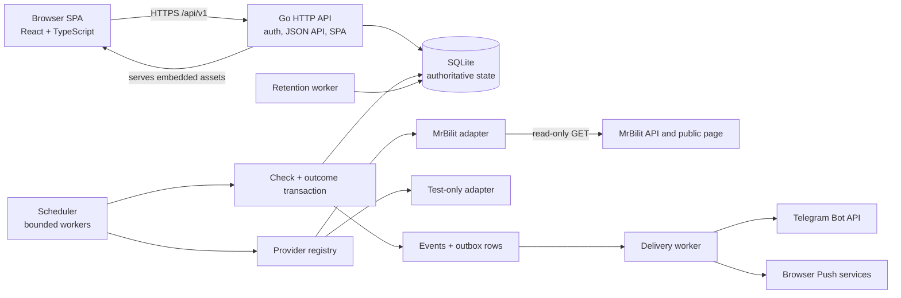

# Neda

Neda is a single-user, self-hosted train-ticket availability monitor for Iranian train routes. It watches selected trains, wagons, and fare classes in the background and sends Telegram and browser Web Push notifications when a monitored option becomes reservable.

Neda is intentionally **not a booking engine**. It never buys, reserves, or holds a ticket. When a booking link can be built safely, it takes the owner to the provider's site to complete the purchase.

**Status (2026-10-26): local release candidate, not production-deployed.** Core monitoring, scheduling, the private API, the dashboard, persistence, the notification pipeline, and retention are implemented and covered by automated tests. Docker/Compose packaging exists. Real Telegram and browser Push delivery, live production provider checks, and target-host deployment have not been validated. See [`docs/RELEASE_READINESS.md`](docs/RELEASE_READINESS.md) for the current audit.

## The problem it solves

Iranian train tickets can appear at unpredictable times, and checking several routes, dates, passenger combinations, and fare classes by hand is repetitive. Neda moves that work to a small service that runs continuously, survives restarts, and reports only meaningful state changes.

The design is deliberately conservative: a provider error, timeout, malformed response, empty result, or ambiguous observation is never presented as "sold out". Availability notifications are only produced from evidence that a specific offering is reservable.

Neda is built for one technical owner who self-hosts the service. It is not SaaS, multi-tenant, or a public ticket-search site.

## Key features

- **Independent monitors** for a route, departure date, adult/child/infant counts, and one or more provider targets. Monitors can be paused, resumed, edited, and deleted; they expire automatically after the departure day ends in Tehran.
- **URL-first MrBilit creation**: paste a public MrBilit train-search URL, review the train → wagon → fare hierarchy, and select the exact wagons or offerings to watch. Future offerings are not added automatically.
- **Background scheduling** with a global polling interval, a bounded worker pool, per-monitor serialization, per-provider spacing, jitter, exponential target backoff, restart recovery, and near-term checks after edits or resume.
- **Conservative availability tracking** using `Reservable`, `NotReservable`, and `Unknown`, durable availability episodes, and deduplicated availability events.
- **Two independent notification channels**: Telegram Bot API and browser Web Push. Both use a transactional outbox, a retrying delivery worker, and per-channel delivery history.
- **Provider health tracking**, separate from ticket availability: last attempt/success/error, consecutive infrastructure failures, one deduplicated degraded episode after three failures, a recovery event, and stale detection.
- **Operational visibility**: overview counts, monitor observations, recent checks, provider health and degraded/recovered events, event history, delivery status, and booking links when available.
- **Private dashboard and JSON API** with owner authentication, sessions, CSRF protection, a Jalali date picker, and English-only responsive light/dark UI.
- **Bounded local data**: embedded forward-only migrations, single-writer SQLite, retention cleanup for diagnostics and history, and no raw provider responses archived.

## Current status at a glance

| Area | State |
|---|---|
| Monitors, scheduler, availability state machine, provider health | Implemented and tested |
| Private HTTP API, dashboard, authentication, settings | Implemented and tested |
| MrBilit adapter and URL-first selected-option flow | Implemented; live-validated for one route/date; production registration is explicit |
| Telegram delivery | Implemented with encrypted credentials, test action, and fake-server tests; real delivery not yet accepted |
| Web Push | Implemented with VAPID, encrypted subscriptions, service worker, and local/browser-simulation tests; real external delivery and closed-browser acceptance not yet run |
| Packaging and target-host deployment | Docker/Compose assets exist; target-host deployment is pending |

Detailed task-by-task history and evidence live in [`docs/IMPLEMENTATION_PLAN.md`](docs/IMPLEMENTATION_PLAN.md). The codebase uses milestone/task IDs such as `M1`–`M5`, `SCH-*`, `NTF-*`, and `PSH-*`; these are development tracking labels, not runtime concepts.

## Supported providers and integrations

| Integration | Status | Details |
|---|---|---|
| **MrBilit** | Real adapter, implemented | Uses `GET https://train.mrbilit.com/api/GetAvailable/v2`. Supports URL search, route IDs, passenger counts, prices, selected wagon/class options, and booking links built only from an accepted route slug and valid date. Development registers it automatically; production requires `NEDA_MRBILIT_ENABLED=true`. |
| **Test provider** | Test-only, implemented | Deterministic fake provider for local workflows and tests. It uses fake-only route IDs, performs no network access, is labelled as a test source in the UI, and is rejected in production. |
| **Telegram Bot API** | Implemented | Bot token and chat ID are stored encrypted; the dashboard can save, clear, and test the configuration. Availability and provider-health events can be delivered. |
| **Browser Web Push** | Implemented | VAPID keys, encrypted subscription storage, service-worker delivery, global enable/pause, per-device test/remove, and SSRF-safe outbound requests. Requires a secure browser context and configured VAPID subject. |
| **Other train providers** | Not implemented | The provider interface and registry are the extension point. No other real train-ticket adapters exist. |

A monitor can contain multiple provider targets at the data-model and scheduler level. Today there is one real provider, and the production creation UI creates one MrBilit target from one search URL; there is no UI for combining several real providers into one monitor.

## How it works

### 1. Create a monitor

For MrBilit, the owner pastes a public URL such as:

```text
https://mrbilit.com/trains/yazd-mashhad?departureDate=1405-08-24
```

Neda validates the URL shape, converts the Jalali date to Gregorian, resolves provider route IDs from the public search page, and performs an initial read-only search. The result is grouped as train → wagon → fare. The owner selects a whole wagon or individual offerings; the exact offering keys and display metadata are persisted in `monitor_provider_selections` against the target's configuration version.

The price filter and sorting in this screen are view-only. They never change the selected offerings, the monitor payload, or availability state. Prices are provider-reported integer amounts; currency and per-passenger basis are not yet verified.

### 2. Schedule checks

The scheduler runs inside the Go process. It selects active, non-expired targets, runs at most one check per monitor at a time, and keeps a configurable number of workers busy (default 2, maximum 16). Provider checks are spaced at least 5 seconds apart per provider.

The global polling interval is a SQLite setting, defaulting to 300 seconds and bounded to 60–3600 seconds. After a check finishes, the next due time is calculated from the completion time with ±10% jitter. The effective start time can be later because of worker capacity, provider spacing, and backoff.

Transient provider failures use exponential target backoff: the first failure waits 2× the interval, and the delay is capped at `max(4× interval, 30 minutes)` with jitter. A provider `Retry-After` value is honored as a lower bound. Configuration, route, and ordinary 4xx errors do not trigger outage backoff. The adapter itself supports bounded HTTP retries, but the current production composition disables them (`NoRetries: true`); scheduler backoff is the active retry mechanism.

Monitors expire at the end of the departure day in `Asia/Tehran`. Pausing stops polling without deleting history. An expired monitor cannot resume until its departure date is edited to a future date.

### 3. Check a provider

Before network I/O, the check stage writes exactly one `check_runs` row in `running` state. It loads the monitor and target configuration, validates the provider configuration, and calls the adapter with one overall 20-second deadline. Redirects are rejected and response sizes are bounded.

After I/O, the outcome runner re-checks that the target still exists, is active and enabled, is not expired, and still has the same configuration version and booking slug. A stale result from a paused, edited, or deleted target is recorded as `discarded` and never updates availability, health, or scheduling. A shutdown or caller cancellation becomes `abandoned`.

### 4. Apply availability and notifications atomically

A successful result is applied in one SQLite transaction:

- inventory states and availability episodes are updated;
- provider health diagnostics and degraded/recovered episodes are updated;
- target scheduling is advanced or backed off;
- events and initial notification deliveries are inserted into the transactional outbox;
- the check run is finalized.

Provider errors finalize the check and update diagnostics without changing offering availability. A provider error, timeout, malformed response, or missing observation is never converted to `NotReservable`.

Provider health is global per provider. Only applicable infrastructure failures count toward the outage threshold; configuration, route, and ordinary 4xx errors update diagnostics without incrementing it. A provider is marked stale when its last successful check is older than `max(3× poll interval, 15 minutes)`, or immediately while a degraded episode is open.

### 5. Deliver and retain

The delivery worker claims committed outbox rows with a lease, sends outside the database transaction, records every attempt, and retries transient failures with bounded delays. Telegram and Push destinations are resolved independently. Delivery is at-least-once; exactly-once external delivery is not claimed.

A daily retention worker prunes bounded diagnostic and notification history. Open availability episodes are never pruned.

## Availability semantics

| State | Meaning |
|---|---|
| `Reservable` | Sufficient positive evidence that the specific offering can be booked for the requested passenger mix, with no unresolved contradiction. A new episode creates one initial event. |
| `NotReservable` | Decisive negative evidence for that offering. A successful negative observation closes the open episode. |
| `Unknown` | Missing, ambiguous, insufficient, contradictory, malformed, errored, or timed-out evidence. It never closes an episode and is never displayed as "sold out". |

Important consequences:

- A valid empty result is a successful query with no returned offerings. It does not close open episodes.
- Repeated `Reservable` observations in one continuous episode do not create duplicate events. A later reservable observation after a confirmed close creates a new event.
- For URL-first MrBilit monitors, only the selected offerings are monitored. Classes that appear in later searches are not added automatically.
- Provider errors, timeouts, discarded results, and abandoned results never overwrite confirmed availability.

The detailed decision rules and transition tables are in [`docs/PRODUCT_SPEC.md`](docs/PRODUCT_SPEC.md) and [`docs/ARCHITECTURE.md`](docs/ARCHITECTURE.md).

## Architecture



The scheduler, delivery worker, and retention worker are goroutines in the same Go process as the HTTP server. SQLite and the in-memory in-flight/spacing state assume a single process and one replica.

### Major components

| Component | Location | Responsibility |
|---|---|---|
| CLI | `cmd/neda` | `serve`, `set-password`, `healthcheck`, and `version`. |
| HTTP API and middleware | `internal/httpapi` | Routing, authentication, CSRF, host validation, JSON errors, health endpoints, settings, history, Push, and SPA serving. |
| Monitor domain | `internal/domain` | Monitor validation, status, expiry, edits, pause/resume/delete, and scheduling intent. |
| Scheduler | `internal/scheduler` | Due selection, worker pool, monitor-wide serialization, spacing, jitter, backoff, restart recovery, check stage, and outcome orchestration. |
| Provider boundary | `internal/provider` | Normalized types, explicit registry, error classification, and capability metadata. Adapters live in `provider/mrbilit` and `provider/fake`. |
| Availability engine | `internal/availability` | Inventory states, episodes, event generation, and expiry closure. |
| Provider health | `internal/health` | Infrastructure-failure counters, degraded episodes, recovery, and stale status. |
| Notifications | `internal/notify` | Transactional outbox, Telegram formatting/client, and the lease-based delivery worker. |
| Web Push | `internal/push` | VAPID keys, subscription validation, encryption, DNS/IP guards, and the sender. |
| Persistence | `internal/db`, `internal/migrations`, `internal/store` | SQLite setup, embedded migrations, repositories, and query models. |
| Authentication and secrets | `internal/auth`, `internal/crypto` | Argon2id passwords, sessions, CSRF, rate limits, key-file validation, and AES-256-GCM setting values. |
| Dashboard | `web/` | React SPA, service worker, typed API client, and frontend tests. It is embedded into the binary with `go:embed`. |
| Retention | `internal/retention` | Daily bounded cleanup of check runs, attempts, events, episodes, sessions, and disabled subscriptions. |

### Data model

| Tables | Purpose |
|---|---|
| `monitors`, `monitor_providers`, `monitor_provider_selections` | Routes, dates, passengers, per-provider targets, config versions, scheduling state, and exact selected offering identities. Inactive targets are retained for history. |
| `check_runs` | One attempt per provider check with sanitized outcome, timing, HTTP status, and counts. |
| `inventory_states`, `availability_episodes` | Latest state per target/config version/journey/offering and the open or closed reservable periods. |
| `events`, `notification_deliveries`, `notification_attempts` | Durable availability and provider-health events, per-channel deliveries, and attempt history. |
| `provider_health`, `provider_health_episodes` | Global per-provider diagnostics and degraded/recovery episodes. |
| `push_subscriptions`, `settings`, `users`, `sessions` | Encrypted Push subscriptions, plain/encrypted settings, the single owner, and hashed session state. |

Configuration changes use a per-target `config_version`. Material changes to route, date, passengers, provider route IDs, or selections close old episodes with `config_changed` and start fresh state; label-only and booking-slug-only edits do not reset availability.

### Technology stack

- **Backend:** Go 1.27.3, standard-library `net/http`, `modernc.org/sqlite`, embedded forward-only SQL migrations, `log/slog`.
- **Frontend:** React 19, TypeScript, Vite 8, Tailwind CSS 4, shadcn/ui and Radix primitives, React Router, `jalaali-js`.
- **Notifications:** direct Telegram Bot API client and `webpush-go` for VAPID/Web Push.
- **Security:** Argon2id, opaque sessions with hashed tokens, double-submit CSRF, AES-256-GCM secret storage with an external key file, strict Host/origin checks, and no CORS.
- **Build:** one Go binary containing the API, background workers, migrations, and embedded frontend assets.

## Dashboard

The frontend is a single-page application served by the Go binary. It is English-only, responsive, and supports light, dark, and system themes.

| Route | Purpose |
|---|---|
| `/login` | Owner sign-in and setup guidance when no password exists. |
| `/` | Monitor-centric overview: attention, active, and paused/expired groups; monitor counts; provider health; recent availability events; and recent deliveries. |
| `/monitors` | Searchable and status-filterable monitor list. |
| `/monitors/new` | URL-first MrBilit search, wagon/fare selection, view-only price filter/sort, passenger confirmation, and monitor creation. |
| `/monitors/:id` | Status, route/date/passengers, selected offerings, last observations, recent checks, provider diagnostics, pause/resume, edit, and delete. |
| `/monitors/:id/edit` | Label edits; material route/date/passenger changes require a fresh selection set. |
| `/events`, `/events/:id` | Availability and provider-health event history, delivery status, filters, cursor pagination, and booking links. |
| `/settings` | Global polling interval, Telegram configuration/test, browser Push devices, password change, and appearance. |

The private REST API lives under `/api/v1` and covers auth, monitors, providers and search, events, deliveries, overview, settings, and Push. `/healthz` and `/readyz` are public; `/api/v1/auth/login` and `/api/v1/auth/session` are intentionally accessible to the login page. The hand-written OpenAPI 3.0.3 document is [`docs/openapi.yaml`](docs/openapi.yaml).

## Current limitations

### Not yet validated

- Real Telegram delivery with owner credentials.
- Real browser-to-Push-service delivery, OS notification clicks, and delivery with the browser fully closed.
- Live production provider checks. MrBilit has been validated with a small number of read-only requests against one route/date.
- Target-host deployment, reverse proxy/TLS, backup/restore on the real host, and long-running resource/retention behavior.
- Human screen-reader, zoom, and contrast review of the dashboard.

### Not implemented or deliberately out of scope

- Ticket purchase, reservation, payment, or seat selection.
- Additional real train providers. MrBilit is the only real adapter.
- A UI for combining multiple real providers in one monitor.
- Multi-user accounts, registration, roles, billing, or public sharing.
- Per-monitor polling intervals; the interval is global.
- Manual "check now".
- Cross-provider journey merging, inventory aggregation, or notification suppression.
- Price history, seat maps, analytics dashboards, email/SMS notifications, or a native mobile app.
- Horizontal scaling or multiple replicas. The scheduler, SQLite, and in-memory concurrency state are single-process.

### Behavioral and operational limits

- Delivery is at-least-once. A crash between sending and recording the result can produce a duplicate notification.
- Provider capacity, child/infant inventory semantics, and price currency/per-passenger basis are not fully verified. Capacity shortfall remains `Unknown`.
- The MrBilit URL resolver depends on route data embedded in the public page, which is not a documented API contract; it fails closed if the page shape changes.
- Login rate limiting and provider spacing are in-memory and reset on restart.
- The retention windows are design defaults; long-term growth has not been measured on the target host.
- The repository does not authorize live provider traffic, real Telegram/Push credentials, or deployment by itself. Follow the project safety rules and obtain owner approval.

## Local development

Prerequisites: Go 1.27.3, Node.js 22.12+ with npm, and `make`.

Run the backend checks:

```bash
make check   # formatting, vet, tests, build
make race    # race-enabled tests
```

Set the owner password offline. The command requires a TTY, reads the password twice without echo, and does not accept a password argument:

```bash
NEDA_ENV=development NEDA_DB_PATH=./data/neda.db go run ./cmd/neda set-password
```

Run the backend. Development registers MrBilit automatically. Add the test-only provider only when you need deterministic local data:

```bash
make run
# or
NEDA_FAKE_PROVIDER_ENABLED=true make run
```

`make run` uses `NEDA_ENV=development`, `NEDA_DB_PATH=./data/neda.db`, and port `8080`.

Run the Vite development server in another terminal. It proxies `/api`, `/healthz`, and `/readyz` to the backend:

```bash
cd web
npm ci
npm run dev
```

Frontend checks:

```bash
cd web
npm run lint
npm run typecheck
npm test
npm run build
```

The frontend must be built before a single-binary production build because assets are embedded with `go:embed`:

```bash
cd web
npm ci
npm run build
cd ..
go build -o neda ./cmd/neda
```

`go build ./...` still succeeds without a frontend build; the API and health routes remain available while the SPA reports that assets are not built.

Ordinary tests use temporary SQLite, fake providers, and fake Telegram/Push endpoints. They do not require live provider access, real credentials, or a running browser.

## Configuration

The service reads environment variables. The settings most relevant to local development and provider behavior are:

| Variable | Default | Purpose |
|---|---|---|
| `NEDA_ENV` | `production` | `development` or `production`. Use `development` locally. |
| `NEDA_HTTP_ADDR` | `:8080` | HTTP listen address. |
| `NEDA_DB_PATH` | `/data/neda.db` | SQLite database path. |
| `NEDA_ENCRYPTION_KEY_FILE` | — | Owner-only file containing a base64 32-byte key. Required in production and needed for Telegram/Push secrets. |
| `NEDA_PUBLIC_URL` | — | Required in production. Exact HTTPS origin for Host/origin checks, links, and Push. |
| `NEDA_VAPID_SUBJECT` | — | `mailto:` contact or HTTPS URL required for Web Push. |
| `NEDA_MRBILIT_ENABLED` | `false` | Must be `true` in production; development registers MrBilit automatically. |
| `NEDA_FAKE_PROVIDER_ENABLED` | `false` | Enables the test-only provider in development/testing. Rejected in production. |
| `NEDA_WORKERS` | `2` | Scheduler worker pool, 1–16. |
| `NEDA_SESSION_TTL_HOURS` | `720` | Absolute session lifetime. |
| `NEDA_SESSION_IDLE_HOURS` | `168` | Idle session timeout. |
| `NEDA_TRUST_PROXY` | `false` | Honor forwarded headers only behind a trusted local proxy. |
| `NEDA_LOG_LEVEL` | `info` | `debug`, `info`, `warn`, or `error`. |
| `NEDA_LOG_FORMAT` | `json` in production, `text` in development | Structured log format. |

The global polling interval is not an environment variable. It is stored in SQLite as `poll_interval_seconds`, seeded to 300 seconds, and bounded to 60–3600 seconds. Changing it affects future scheduling decisions; existing `next_due_at` values are not recalculated immediately.

Production startup fails closed when required production configuration is missing, when the real provider is not enabled, when the fake provider is enabled, when the provider registry is empty, or when active monitors reference an unregistered provider. See [`.env.example`](.env.example) for placeholders and [`docs/ARCHITECTURE.md`](docs/ARCHITECTURE.md) for the full configuration and security model.

## Operations

- **Initial password:** use `neda set-password` in an interactive terminal. There is no unauthenticated web bootstrap.
- **Telegram and Push:** configure them from **Settings**. Credentials and subscription material are encrypted with the external key; the UI never redisplays stored secrets.
- **Backups:** the SQLite database and encryption key must be backed up together. A database without its key cannot decrypt Telegram/Push settings. See [`docs/ENCRYPTION.md`](docs/ENCRYPTION.md) and [`docs/BACKUP_RESTORE_DRILL.md`](docs/BACKUP_RESTORE_DRILL.md).
- **Deployment:** Docker/Compose files and a first-time setup script exist, but target-host deployment has not been performed or approved. The deployment plan, proxy/TLS, and rollback steps are in [`docs/DEPLOYMENT.md`](docs/DEPLOYMENT.md). They are not covered by this README.

## Documentation

### Product and planning

- [`docs/BRIEF.md`](docs/BRIEF.md) — authoritative product and engineering brief.
- [`docs/PRODUCT_SPEC.md`](docs/PRODUCT_SPEC.md) — behavior, assumptions, and acceptance criteria.
- [`docs/IMPLEMENTATION_PLAN.md`](docs/IMPLEMENTATION_PLAN.md) — tasks, gates, status, and verification evidence.
- [`docs/RELEASE_READINESS.md`](docs/RELEASE_READINESS.md) — current release audit, blockers, and known limitations.

### Architecture and security

- [`docs/ARCHITECTURE.md`](docs/ARCHITECTURE.md) — components, schema, provider boundary, scheduler/state design, security, and testing.
- [`docs/SECURITY.md`](docs/SECURITY.md) — threat model, controls, findings, and residual risks.
- [`docs/ENCRYPTION.md`](docs/ENCRYPTION.md) — encryption-key lifecycle and recovery constraints.
- [`docs/DEPENDENCIES.md`](docs/DEPENDENCIES.md) — dependency inventory, licenses, and vulnerability scans.
- [`docs/RESOURCE_MEASUREMENT.md`](docs/RESOURCE_MEASUREMENT.md) — local synthetic resource measurements and limitations.

### Provider and UI evidence

- [`docs/MRBILIT_LIVE_VALIDATION.md`](docs/MRBILIT_LIVE_VALIDATION.md) — bounded live request evidence and observed provider semantics.
- [`docs/MRBILIT_URL_FIRST.md`](docs/MRBILIT_URL_FIRST.md) — URL-first creation, selection matching, and live-search evidence.
- [`docs/BROWSER_PUSH_VALIDATION.md`](docs/BROWSER_PUSH_VALIDATION.md) — browser service-worker/Push simulation and permission-denial evidence.
- [`docs/FRONTEND_ACCEPTANCE.md`](docs/FRONTEND_ACCEPTANCE.md) — dashboard acceptance checklist and automated browser audit results.

### Operations and API

- [`docs/DEPLOYMENT.md`](docs/DEPLOYMENT.md) — deployment plan, proxy/TLS, backup/restore, and rollback.
- [`docs/BACKUP_RESTORE_DRILL.md`](docs/BACKUP_RESTORE_DRILL.md) — local backup/restore evidence.
- [`docs/openapi.yaml`](docs/openapi.yaml) — OpenAPI 3.0.3 description of the implemented API.

## Working in this repository

- Read [`AGENTS.md`](AGENTS.md) before making changes. It defines the repository safety rules, the staged workflow, and the task-tracking contract.
- Treat [`docs/BRIEF.md`](docs/BRIEF.md) as the authoritative product source and [`docs/IMPLEMENTATION_PLAN.md`](docs/IMPLEMENTATION_PLAN.md) as the single task tracker.
- Keep provider-specific parsing and availability rules inside adapters. The scheduler and state engine consume normalized outcomes only.
- Preserve the fail-closed availability rules: never infer `NotReservable` from an error, timeout, empty result, missing observation, or ambiguous identity.
- Use deterministic tests and fixtures. Do not make live MrBilit, Telegram, or Push calls in ordinary tests or CI, and do not commit credentials, keys, subscription endpoints, databases, or generated graph data.
- [`docs/CODEGRAPH_WORKFLOW.md`](docs/CODEGRAPH_WORKFLOW.md) describes the optional CodeGraph navigation policy for this repository.
