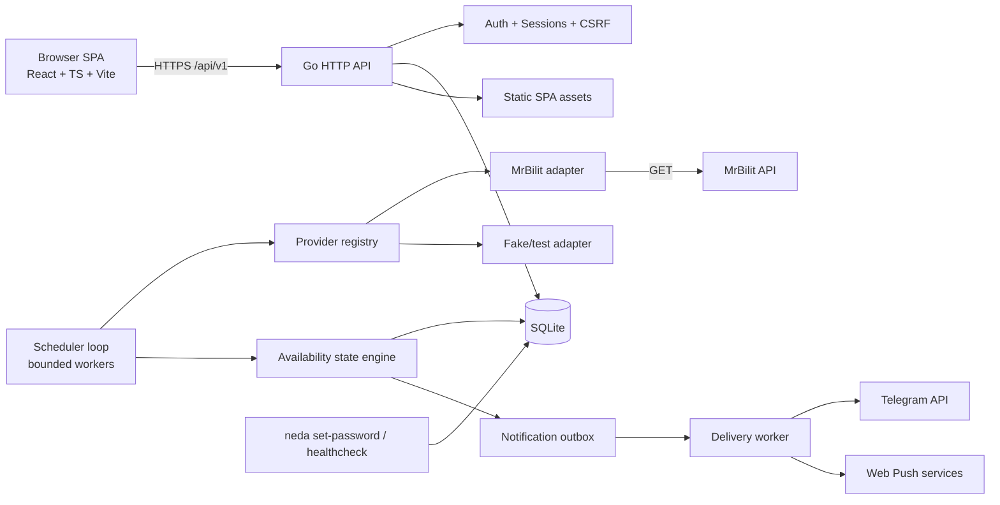
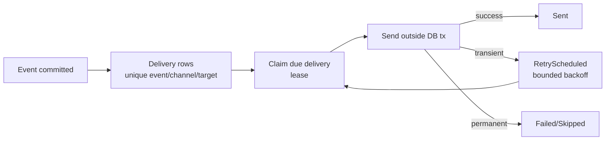

# Neda — Architecture

**Status:** Planning baseline approved under `GATE-001` (2026-10-23). Implementation proceeds under `GATE-002` only within the scope recorded in `IMPLEMENTATION_PLAN.md`.
**Date:** 2026-10-23
**Authoritative source:** `docs/BRIEF.md`. Behavior details are in `PRODUCT_SPEC.md`; task tracking is in `IMPLEMENTATION_PLAN.md`.
**Repository path:** `docs/ARCHITECTURE.md`

**Classification legend:** `VERIFIED`, `PROVISIONAL`, `REQUIRES OWNER INPUT` (same meaning as `PRODUCT_SPEC.md`).

---

## 1. Context and constraints

- Single-user, self-hosted application; not SaaS, not multi-tenant.
- One Go backend service with a persistent background monitoring worker.
- Browser may be closed; monitoring is server-side.
- Low-resource Ubuntu target; exact CPU/RAM/disk are unknown and must not be invented.
- SQLite is authoritative; in-memory state is not.
- React/TypeScript/Vite/Tailwind/shadcn dashboard, English-only.
- Telegram and real browser Web Push, independent channels.
- Iran-focused routes; departure-day expiry in `Asia/Tehran`.
- Provider behavior, especially MrBilit's, is not fully verified. The architecture must fail closed and make uncertainty explicit.
- CodeGraph is a navigation/impact aid only; it does not replace tests, builds, source inspection, or security review.
- No production server access until a separate deployment plan is approved.

---

## 2. High-level architecture



### 2.1 Components and responsibilities

| Component | Responsibility | Must not do |
|---|---|---|
| HTTP API | Auth, monitor CRUD, settings, events/deliveries, Push subscriptions, health, static SPA | Contain provider JSON parsing or ticket rules |
| Auth/session | Password verification, session issuance, CSRF, rate limiting | Store raw session tokens or plaintext secrets |
| Scheduler | Due-time selection, bounded concurrency, jitter, backoff, restart recovery, expiry | Spawn unbounded goroutines or poll paused/expired jobs |
| Provider registry | Explicit adapter registration and lookup | Reflection/plugin loading |
| Provider adapter | Request building, HTTP, parsing, normalized observations, provider-specific reservability and booking URL | Write SQLite or create events/deliveries |
| Availability state engine | Atomic state/episode/event/outbox transitions, dedupe, config-version reset | Treat errors/unknowns/empty lists as sold out |
| Notification outbox/worker | Durable delivery, independent channels, retries, status | Roll back inventory state on send failure |
| SQLite | Authoritative state, episodes, events, deliveries, health, settings | Store raw provider responses indefinitely or secrets in plaintext |
| CLI | Interactive password setup, healthcheck, version, maybe backup | Expose a public bootstrap endpoint or accept password args |

---

## 3. Technology decisions

### 3.1 Baseline stack (no deviation)

- Backend: Go, `net/http` (standard library), versioned REST API, SQLite, explicit migrations, structured logging, graceful shutdown.
- Frontend: React, TypeScript, Vite, Tailwind CSS, shadcn/ui.
- Deployment: Docker Compose, multi-stage image, non-root runtime, persistent volumes.
- No Next.js, Redis, Kubernetes, separate worker container, external DB, or message broker.

### 3.2 Concrete choices and evaluations

| Area | Proposed choice | Status | Rationale / fallback |
|---|---|---|---|
| SQLite driver | `modernc.org/sqlite` (pure Go) | PROVISIONAL | No CGO, easier static/ARM64/AMD64 builds. Must verify performance, WAL behavior, busy handling, and maintenance. Fallback: `mattn/go-sqlite3` with CGO, documented tradeoff. |
| Migrations | Small embedded SQL runner (`embed`, sorted files, checksums, `schema_migrations`) | PROVISIONAL | Explicit, no heavy ORM. Must test transaction/rollback/checksum behavior. |
| Data access | Small explicit repository layer over `database/sql` | PROVISIONAL | No ORM. Keep SQL close to schema and testable. |
| UUIDs | `github.com/google/uuid` or an equivalent maintained library | PROVISIONAL | Stable IDs; evaluate at implementation. A small local ID helper is acceptable if it is correct and tested. |
| Password hash | `golang.org/x/crypto/argon2` (Argon2id) | PROVISIONAL | Brief prefers Argon2id. Parameters must be benchmarked on the target class; default proposal 64 MiB / 3 iterations / 2 lanes, adjustable. |
| Telegram | Direct `net/http` Bot API client | PROVISIONAL | No heavy SDK. Test with `httptest`; fixed API base; redacted errors. |
| Web Push | A maintained Go Web Push/VAPID library (evaluate `webpush-go` or equivalent) | PROVISIONAL | Must support current VAPID/encryption, endpoint cleanup, and tests. Do not hand-roll cryptography. |
| Jalali conversion (Go) | A maintained Persian-calendar library (evaluate current options) | PROVISIONAL | Do not implement conversion manually. Confirm leap-year/boundary behavior and maintenance. |
| Jalali conversion (TS) | A maintained library (evaluate `jalaali-js` or equivalent) | PROVISIONAL | Same rule; no manual algorithm. |
| Forms | React Hook Form + Zod | PROVISIONAL | Standard with shadcn; server validation remains authoritative. |
| Server state | Small typed `fetch` client + local hooks; no TanStack Query initially | PROVISIONAL | Keeps dependency/bundle small; dashboard polling is simple. Revisit only if complexity is demonstrated. |
| Service worker | Hand-written `web/public/sw.js`; no Workbox | PROVISIONAL | Small scope; avoids build plugin complexity. Must handle push/click/subscription-change. |
| UI icons/toasts | lucide-react, shadcn `sonner` | PROVISIONAL | Standard shadcn ecosystem; confirm at scaffold. |

### 3.3 Deliberate non-choices

- No ORM, reflection-based DI, plugin framework, generic event bus, CQRS, or microservices.
- No separate metrics stack (Prometheus/Grafana) in v1. Structured logs + health/readiness + dashboard diagnostics are sufficient.
- No full browser E2E framework initially; Vitest/Testing Library + a manual acceptance checklist.
- No OpenAPI code generation; a hand-written minimal spec is optional P2.
- No city catalogue or custom filters.

---

## 4. Proposed repository tree

Existing starter files are preserved. Paths are proposals, not yet created.

```text
neda/
├── AGENTS.md
├── README.md                         # replaced with the English planning-state README before the initial documentation commit
├── START_PROMPT.md                   # preserve starter file unless owner asks to archive it
├── docs/
│   ├── BRIEF.md
│   ├── CODEGRAPH_WORKFLOW.md
│   ├── PRODUCT_SPEC.md
│   ├── ARCHITECTURE.md
│   ├── IMPLEMENTATION_PLAN.md
│   ├── .codegraph/                   # local generated empty index; must be ignored, not yet ignored at root
│   ├── SECURITY.md                   # optional consolidation; security section below is authoritative initially
│   └── DEPLOYMENT.md                 # created after server facts/deployment plan approval
├── .env.example                      # placeholders only
├── .gitignore
├── .dockerignore
├── go.mod
├── go.sum
├── Makefile
├── Dockerfile
├── compose.yaml
├── cmd/
│   └── neda/
│       └── main.go                   # serve (default), set-password, healthcheck, version
├── internal/
│   ├── config/
│   ├── logging/
│   ├── clock/                        # injectable clock for tests
│   ├── crypto/                       # AES-GCM, key loading, redaction helpers
│   ├── db/                           # open, PRAGMAs, migrations, tx helper
│   ├── migrations/                   # embedded *.sql, forward-only
│   ├── store/                        # explicit repositories
│   ├── domain/                       # monitors, providers, observations, events
│   ├── provider/
│   │   ├── provider.go               # normalized types, interface, errors, registry
│   │   ├── fake/                     # deterministic test provider
│   │   └── mrbilit/                  # request, client, parser, classification, booking URL
│   ├── scheduler/
│   ├── availability/                 # state machine, episodes, dedupe
│   ├── health/                       # provider health episodes
│   ├── notify/
│   │   ├── outbox.go
│   │   ├── format.go
│   │   ├── telegram.go
│   │   └── push.go
│   ├── push/                         # VAPID, subscription validation, sender interface
│   ├── calendar/                     # Jalali conversion wrapper
│   ├── auth/                         # Argon2id, sessions, CSRF, rate limits
│   ├── httpapi/                      # router, middleware, handlers, DTOs
│   ├── retention/
│   └── webui/                        # embed web/dist; SPA fallback
├── web/
│   ├── index.html
│   ├── package.json
│   ├── package-lock.json
│   ├── vite.config.ts
│   ├── tsconfig.json
│   ├── eslint.config.js
│   ├── components.json
│   ├── public/
│   │   ├── sw.js
│   │   └── icons...
│   ├── dist/                         # generated; gitignored except .gitkeep
│   └── src/
│       ├── main.tsx
│       ├── App.tsx
│       ├── api/
│       ├── components/
│       │   ├── ui/                   # shadcn-generated components
│       │   ├── layout/
│       │   ├── monitors/
│       │   ├── events/
│       │   └── settings/
│       ├── hooks/
│       ├── lib/                      # dates, formatting, CSRF, errors
│       ├── pages/
│       ├── styles.css
│       └── test/
├── testdata/
│   └── mrbilit/
│       ├── observed/                 # sanitized real samples, if captured
│       └── synthetic/                # explicitly synthetic edge cases
├── scripts/                          # optional local helpers; no secrets
├── .github/
│   └── workflows/
│       └── ci.yml
└── .codegraph/                       # local generated graph; must be gitignored, never committed
```

Notes:

- `web/dist` is generated. To keep `go test ./...` compilable before a frontend build, commit `web/dist/.gitkeep` and use `//go:embed all:dist`; production builds replace the directory contents. This is a build convenience, not a source of truth.
- `.codegraph/` and `**/.codegraph/` are in the committed root `.gitignore`; `git check-ignore` confirms the root and nested graph data are ignored. A nested `docs/.codegraph/` exists locally and must remain uncommitted.
- The README and normal repository documentation are English-only unless a specific product requirement explicitly requires another language. `REPO-003` prepares the English planning-state README for the initial documentation commit; it must describe the repository as planning-stage, explicitly state that application implementation is not yet present, and be reviewed against the actual files before that commit. It must not contain invented commands, environment-variable names/values, unimplemented features, configuration placeholders presented as supported settings, or secrets. Real configuration/setup sections are deferred until the implementation and configuration exist; `FND-012` may add only verified sections as implementation starts, and `OPS-004` completes the final README. The full eventual README scope is in `PRODUCT_SPEC.md` §3.11.
- Do not commit `.env`, databases, WAL/SHM files, keys, Push subscriptions, logs, `node_modules`, or build artifacts.

---

## 5. Process and startup model

One binary, one long-lived process, one container replica. The scheduler and notification worker are goroutines inside the process.

### 5.1 CLI

```text
neda                     # default: serve
neda serve               # explicit serve
neda set-password        # interactive TTY only; no password argument
neda healthcheck         # local HTTP health probe for container HEALTHCHECK
neda version
```

Optional later: `neda backup` (online `VACUUM INTO`), `neda migrate` dry-run. Not v1 requirements.

### 5.2 Startup sequence

1. Load and validate environment/config. Fail closed if the encryption key file is missing/unreadable in production.
2. Open SQLite, set PRAGMAs, apply pending migrations (with checksum verification), verify `foreign_key_check`/`integrity_check` as appropriate.
3. Initialize structured logger and redaction.
4. Load VAPID key material (generate once if absent, encrypt private key, persist) and Telegram settings (decrypt on demand).
5. Build the explicit provider registry. Register MrBilit; register the fake provider only when explicitly enabled for development/testing.
6. Start the scheduler, notification worker, and retention worker with a root context.
7. Start the HTTP server (timeouts, body limits, middleware).
8. On SIGINT/SIGTERM: stop accepting requests, cancel scheduler/worker contexts, wait bounded for in-flight work, close DB, log shutdown. Do not mark canceled provider checks as provider failures; transition their `running` check-run rows to `abandoned` if the DB is still available, otherwise leave them `running` for startup recovery.

### 5.3 Single-instance constraint

SQLite and the in-memory in-flight map assume one process/replica. Docker Compose must run exactly one `neda` service. Horizontal scaling is out of scope. If future scaling is needed, a DB lease/queue redesign is required and must be approved.

---

## 6. Configuration

### 6.1 Environment variables

Secrets are supplied as files, not committed. Values below are placeholders in `.env.example`.

| Variable | Required | Default | Secret | Purpose |
|---|---|---|---|---|
| `NEDA_ENV` | no | `production` | no | `development`/`production`; controls secure cookies/log format. |
| `NEDA_HTTP_ADDR` | no | `:8080` | no | Listen address inside container. |
| `NEDA_DB_PATH` | no | `/data/neda.db` | no | SQLite path on persistent volume. |
| `NEDA_ENCRYPTION_KEY_FILE` | yes | — | yes (file) | 32-byte master key file, owner-only (`0400`/`0600`), outside DB. |
| `NEDA_PUBLIC_URL` | yes in production | — | no | Canonical HTTPS origin for links/cookies; also used for VAPID/event links. |
| `NEDA_VAPID_SUBJECT` | for Push | — | no | `mailto:` or HTTPS contact required by VAPID. |
| `NEDA_LOG_LEVEL` | no | `info` | no | `debug`/`info`/`warn`/`error`. |
| `NEDA_TRUST_PROXY` | no | `false` | no | Trust `X-Forwarded-*` only behind a known proxy. |
| `NEDA_FAKE_PROVIDER_ENABLED` | no | `false` | no | Development/test only; UI labels fake provider clearly. |
| `NEDA_SESSION_TTL_HOURS` | no | `720` (30 days) | no | Absolute session lifetime. |
| `NEDA_SESSION_IDLE_HOURS` | no | `168` (7 days) | no | Idle timeout. |
| `NEDA_WORKERS` | no | `2` | no | Scheduler worker bound (small range; validate). |
| `NEDA_LOG_FORMAT` | no | `json` in prod | no | `json`/`text`. |

Global polling interval is stored in SQLite settings (default 300s, bounds 60–3600s), not an env var, so the dashboard is authoritative after first run. Startup seeds missing defaults with `INSERT OR IGNORE` (poll interval, Push enabled=false, app metadata); it never overwrites operator-set values.

### 6.2 Key material

- **Encryption key:** 32 random bytes, base64-encoded text (loader trims whitespace, decodes exactly 32 bytes); file mode must be owner-only (`0400` or `0600`), owned by the runtime UID/GID. Production startup fails closed if the key is missing, unreadable, or group/world-accessible. Never auto-generate silently in production.
- **Key delivery (one coherent option per deployment):**
  - **Compose secret with explicit permissions:** long-form service secret with `uid`/`gid` matching the runtime user and `mode: 0400`. This must be verified on the actual Compose/platform version; do not assume short-form secret defaults are `0600` or readable by a non-root user.
  - **Read-only bind mount:** host file mode `0600`, owned by the runtime UID/GID, mounted read-only at `/run/secrets/neda_encryption_key`.
  - The chosen option, actual UID/GID, and backup path are recorded in `docs/DEPLOYMENT.md`; final deployment values remain behind `GATE-004`.
- **Startup validation:** verify key readability and permissions before opening encrypted settings; log only a safe configuration error category, never the path contents or key.
- **VAPID keys:** generated once and persisted; private key encrypted with the master key in `settings`; public key stored plaintext. If the master key is lost, Push config/subscriptions cannot be decrypted and must be reset; document this.
- **Backups:** DB + encryption key are both required. Backing up only one is insufficient. Key rotation is not v1; a version column allows future migration.

**P2 encryption implementation (2026-10-24).** `internal/crypto` implements the key-file checks above (regular non-symlink file, owner-only mode, runtime-UID ownership, base64/32-byte validation, bounded read) and versioned AES-256-GCM setting values (`v1:` envelope, fresh nonce, setting-key-bound AAD). `internal/config` delegates `NEDA_ENCRYPTION_KEY_FILE` validation to that loader, so production startup uses the same fail-closed checks. Encryption/decryption failures expose stable categories only and return no plaintext. Key generation and rotation remain operator/future work.

### 6.3 Settings stored in SQLite

Plain: poll interval, Push enabled flag, Telegram last-test metadata, VAPID public key, schema/app version metadata.
Encrypted: Telegram bot token, Telegram chat ID, VAPID private key, Push subscription endpoint/keys.
Never returned raw: tokens, private keys, subscription endpoints/keys.

---

## 7. SQLite schema and migrations

### 7.1 Connection settings

On every connection:

```sql
PRAGMA foreign_keys = ON;
PRAGMA journal_mode = WAL;
PRAGMA synchronous = FULL;
PRAGMA busy_timeout = 5000;
PRAGMA wal_autocheckpoint = 1000;
PRAGMA journal_size_limit = 67108864; -- 64 MiB cap for WAL growth
```

Use a single `*sql.DB` with `SetMaxOpenConns(1)` initially. This is the clear single-writer strategy; transactions are short and never contain network I/O. WAL still improves crash safety/read behavior. Revisit only if measurements show HTTP read starvation; do not add a second writer without a concurrency design.

**Provisional durability policy:** `synchronous=FULL` is chosen because state transitions, episodes, events, and outbox rows are correctness-critical and write volume is low. In WAL mode, `FULL` fsyncs each commit; `NORMAL` is faster but can lose recently committed transactions on OS/power loss (the database remains consistent). Changing to `NORMAL` requires a documented owner-approved tradeoff and must not be described as full power-loss durability. Per-connection PRAGMAs must be applied through the driver/DSN or a connection hook so a replacement connection cannot silently lose `foreign_keys`, `busy_timeout`, or `synchronous`. `FND-007` must assert the effective `synchronous` value (`2`/`FULL`) on both the initial and a replacement connection.

### 7.2 Tables

Timestamps are UTC RFC3339 text. Calendar dates are `YYYY-MM-DD` text. Booleans are INTEGER 0/1 with CHECK constraints. Money is integer minor units plus provider-reported currency when known.

#### `schema_migrations`

| Column | Type | Notes |
|---|---|---|
| `version` | INTEGER PK | Monotonic migration version. |
| `name` | TEXT NOT NULL | File name. |
| `checksum` | TEXT NOT NULL | SHA-256 of file; editing an applied migration is an error. |
| `applied_at` | TEXT NOT NULL | UTC. |

#### `settings`

| Column | Type | Notes |
|---|---|---|
| `key` | TEXT PK | Stable key, e.g. `telegram.bot_token`. |
| `value` | TEXT NOT NULL | Plain JSON/text or base64(nonce‖ciphertext). |
| `is_secret` | INTEGER NOT NULL CHECK (is_secret IN (0,1)) | 0/1. |
| `key_version` | INTEGER NULL | Encryption key version for secrets. |
| `updated_at` | TEXT NOT NULL | UTC. |

#### `users` (single row)

| Column | Type | Notes |
|---|---|---|
| `id` | INTEGER PK CHECK (id = 1) | Single user. |
| `password_hash` | TEXT NOT NULL | Argon2id encoded hash. |
| `password_changed_at` | TEXT NOT NULL | UTC. |
| `created_at` | TEXT NOT NULL | UTC. |

No row means password not configured; login returns a clear setup-required error; no web bootstrap.

#### `sessions`

| Column | Type | Notes |
|---|---|---|
| `id` | TEXT PK | Random ID. |
| `token_hash` | BLOB NOT NULL UNIQUE | SHA-256 of the raw cookie token; raw token never stored. |
| `csrf_hash` | BLOB NOT NULL | SHA-256 of the raw CSRF token returned to the authenticated client. |
| `created_at` | TEXT NOT NULL | UTC. |
| `last_seen_at` | TEXT NOT NULL | UTC. |
| `expires_at` | TEXT NOT NULL | Absolute expiry. |
| `revoked_at` | TEXT NULL | Logout/password change. |
| `user_agent` | TEXT NULL | Truncated; no IP required. |

Indexes: `token_hash`, `expires_at`.

#### `monitors`

| Column | Type | Notes |
|---|---|---|
| `id` | TEXT PK | UUID/ULID. |
| `label` | TEXT NOT NULL | 1–100 chars. |
| `origin_name` | TEXT NOT NULL | Canonical display. |
| `destination_name` | TEXT NOT NULL | Canonical display. |
| `departure_date` | TEXT NOT NULL | Gregorian `YYYY-MM-DD`. |
| `adults` | INTEGER NOT NULL CHECK (adults >= 1) | Bounded in app. |
| `children` | INTEGER NOT NULL CHECK (children >= 0) | Bounded in app. |
| `infants` | INTEGER NOT NULL CHECK (infants >= 0) | Bounded in app. |
| `enabled` | INTEGER NOT NULL DEFAULT 1 CHECK (enabled IN (0,1)) | Pause flag. |
| `expires_at` | TEXT NOT NULL | Authoritative expiry: end of departure day in Tehran, UTC; recomputed on date edit. |
| `expired_at` | TEXT NULL | Set when expiry is observed; cleared when a material date edit recomputes a future `expires_at`; not a terminal manual state. |
| `created_at` | TEXT NOT NULL | UTC. |
| `updated_at` | TEXT NOT NULL | UTC. |

Index: `(enabled, expires_at)`, `(departure_date)`.

#### `monitor_providers`

| Column | Type | Notes |
|---|---|---|
| `id` | INTEGER PK AUTOINCREMENT | Internal target ID. |
| `monitor_id` | TEXT NOT NULL FK → monitors ON DELETE CASCADE | |
| `provider_id` | TEXT NOT NULL | Registry ID, e.g. `mrbilit`. |
| `active` | INTEGER NOT NULL DEFAULT 1 CHECK (active IN (0,1)) | 0 when removed from the monitor; row/history retained. |
| `origin_id` | TEXT NOT NULL | Provider-native; opaque to core. |
| `destination_id` | TEXT NOT NULL | Provider-native. |
| `booking_slug` | TEXT NULL | Optional validated slug. |
| `gender_code` | TEXT NULL | Optional, only after validated need. |
| `config_version` | INTEGER NOT NULL DEFAULT 1 | Bumped on material changes. |
| `next_due_at` | TEXT NULL | UTC; scheduler computes. |
| `last_attempt_at` | TEXT NULL | UTC. |
| `last_success_at` | TEXT NULL | UTC. |
| `last_outcome` | TEXT NULL CHECK (last_outcome IN ('success','empty','error') OR last_outcome IS NULL) | success/empty/error; discarded/abandoned results are recorded only in `check_runs`. |
| `last_error_kind` | TEXT NULL | Stable category. |
| `last_error_at` | TEXT NULL | UTC. |
| `consecutive_failures` | INTEGER NOT NULL DEFAULT 0 CHECK (consecutive_failures >= 0) | Target-level; distinct from provider health. |
| `created_at` | TEXT NOT NULL | UTC. |
| `updated_at` | TEXT NOT NULL | UTC. |

Constraints: `UNIQUE(monitor_id, provider_id)`. Indexes: `(next_due_at)`, `(provider_id)`.

#### `check_runs`

One row per monitor-provider check attempt. This is the bounded diagnostic history; no per-poll raw payloads.

| Column | Type | Notes |
|---|---|---|
| `id` | INTEGER PK AUTOINCREMENT | |
| `monitor_provider_id` | INTEGER NOT NULL FK → monitor_providers ON DELETE CASCADE | |
| `config_version` | INTEGER NOT NULL | Version checked. |
| `started_at` | TEXT NOT NULL | UTC; set when the attempt-start row is inserted. |
| `finished_at` | TEXT NULL | Must be NULL iff `outcome='running'`; set when the final outcome is recorded or startup abandons a running row. |
| `outcome` | TEXT NOT NULL | `CHECK (outcome IN ('running','success','empty','error','discarded','abandoned'))`; exactly one final outcome after `running`. |
| `error_kind` | TEXT NULL | Stable category; may hold `booking_config_changed` for a URL-safety discard. |
| `http_status` | INTEGER NULL | No body/header secrets. |
| `duration_ms` | INTEGER NULL | |
| `journey_count` | INTEGER NOT NULL DEFAULT 0 | |
| `offering_count` | INTEGER NOT NULL DEFAULT 0 | |
| `reservable_count` | INTEGER NOT NULL DEFAULT 0 | |
| `not_reservable_count` | INTEGER NOT NULL DEFAULT 0 | |
| `unknown_count` | INTEGER NOT NULL DEFAULT 0 | |
| `warning_count` | INTEGER NOT NULL DEFAULT 0 | |
| `created_at` | TEXT NOT NULL | UTC. |

Indexes: `(monitor_provider_id, started_at DESC)`, `(started_at)`. Retention: 14 days proposed.

**Attempt lifecycle.** `SCH-004` inserts exactly one `check_runs` row with `outcome='running'`, `started_at`, and the request’s `config_version` in a short attempt-start transaction before provider I/O. That transaction writes only `check_runs`; it never updates target timing/scheduling, availability, episodes, provider health, events, or outbox. If the target row is already missing or the start transaction cannot commit, the attempt is not started and no provider request is made. `SCH-010` transitions the same row to exactly one final outcome (`success`, `empty`, `error`, `discarded`, or `abandoned`) in the outcome transaction, conditionally with `WHERE id = ? AND outcome = 'running'`, and sets `finished_at`; zero updated rows means the outcome is not applied and the transaction rolls back. A discarded or abandoned result never updates `monitor_providers` timing/scheduling/diagnostic fields; it only transitions the existing running row. Startup recovery changes every remaining `outcome='running'` row to `abandoned` and sets `finished_at`, with no other writes. If the target or attempt row was cascade-deleted, no diagnostic row can legally be preserved; do not promise one. Add `CHECK ((outcome='running' AND finished_at IS NULL) OR (outcome<>'running' AND finished_at IS NOT NULL))`.

**Enum/boolean validation.** Enforce these with CHECK constraints (or equivalent repository validation plus tests): `check_runs.outcome` and the `finished_at` consistency rule above; `monitors.enabled IN (0,1)`; `monitor_providers.active IN (0,1)`; `monitor_providers.last_outcome IN ('success','empty','error') OR NULL`; `settings.is_secret IN (0,1)`; `availability_episodes.close_reason IN ('not_reservable','config_changed','expired','deleted') OR NULL`; `notification_attempts.status IN ('sending','sent','failed','skipped')`; `notification_attempts.attempt_no >= 1`; non-negative counters for `monitor_providers.consecutive_failures`, `notification_deliveries.attempt_count`, `provider_health.consecutive_failures`, `provider_health_episodes.failure_count_at_open`, and `push_subscriptions.failure_count`. No unvalidated free-text status values.

#### `inventory_states`

Current snapshot per offering, scoped to a monitor-provider and config version. No history table per poll; transitions are captured by episodes/events.

| Column | Type | Notes |
|---|---|---|
| `id` | INTEGER PK AUTOINCREMENT | |
| `monitor_provider_id` | INTEGER NOT NULL FK → monitor_providers ON DELETE CASCADE | |
| `config_version` | INTEGER NOT NULL | |
| `journey_key` | TEXT NOT NULL | Adapter-built stable key. |
| `offering_key` | TEXT NOT NULL | Adapter-built stable key. |
| `state` | TEXT NOT NULL CHECK (state IN ('reservable','not_reservable','unknown')) | |
| `state_since` | TEXT NOT NULL | UTC. |
| `last_observed_at` | TEXT NOT NULL | UTC; when present in a successful result. |
| `last_decisive_at` | TEXT NULL | Last Reservable/NotReservable evidence. |
| `last_missing_at` | TEXT NULL | Last successful check where this key was absent. |
| `last_reason` | TEXT NULL | Stable reason code, e.g. `capacity_zero_unavailable`. |
| `last_capacity` | INTEGER NULL | Provider-reported; diagnostic. |
| `train_number` | TEXT NULL | Snapshot. |
| `operator` | TEXT NULL | Snapshot. |
| `origin_name` | TEXT NULL | Snapshot. |
| `destination_name` | TEXT NULL | Snapshot. |
| `departure_at` | TEXT NULL | Normalized UTC or null if not parseable. |
| `arrival_at` | TEXT NULL | Normalized UTC or null. |
| `wagon_name` | TEXT NULL | Snapshot. |
| `class_name` | TEXT NULL | Snapshot. |
| `price_amount` | INTEGER NULL | Minor units if validated; otherwise null. |
| `price_currency` | TEXT NULL | Provider-reported; no assumption. |
| `last_booking_url` | TEXT NULL | Validated URL only. |
| `updated_at` | TEXT NOT NULL | UTC. |

Constraints: `UNIQUE(monitor_provider_id, config_version, journey_key, offering_key)`. Index: `(monitor_provider_id, config_version, state)`.

#### `availability_episodes`

| Column | Type | Notes |
|---|---|---|
| `id` | INTEGER PK AUTOINCREMENT | |
| `state_id` | INTEGER NOT NULL FK → inventory_states ON DELETE CASCADE | |
| `episode_seq` | INTEGER NOT NULL | 1,2,3… per state. |
| `opened_at` | TEXT NOT NULL | UTC. |
| `closed_at` | TEXT NULL | NULL = open. |
| `close_reason` | TEXT NULL CHECK (close_reason IN ('not_reservable','config_changed','expired','deleted') OR close_reason IS NULL) | `not_reservable`, `config_changed`, `expired`, `deleted`. |
| `UNIQUE(state_id, episode_seq)` | | |

Partial unique index: `CREATE UNIQUE INDEX ... ON availability_episodes(state_id) WHERE closed_at IS NULL;` — enforces at most one open episode per state.

#### `events`

Unified durable events for availability and provider health. Availability events are `kind='availability'`; provider-health events are `kind='provider_degraded'`/`'provider_recovered'`.

| Column | Type | Notes |
|---|---|---|
| `id` | TEXT PK | Stable UUID/ULID. |
| `kind` | TEXT NOT NULL CHECK (kind IN ('availability','provider_degraded','provider_recovered')) | |
| `dedupe_key` | TEXT NOT NULL UNIQUE | e.g. `availability:episode:<id>`, `health:<provider>:<episode>:degraded`. |
| `monitor_id` | TEXT NULL FK → monitors ON DELETE CASCADE | Null for provider events. |
| `provider_id` | TEXT NOT NULL | |
| `episode_id` | INTEGER NULL FK → availability_episodes ON DELETE CASCADE | Availability only. |
| `occurred_at` | TEXT NOT NULL | UTC. |
| `train_number` | TEXT NULL | Availability snapshot. |
| `operator` | TEXT NULL | |
| `origin_name` | TEXT NULL | |
| `destination_name` | TEXT NULL | |
| `departure_at` | TEXT NULL | UTC if known. |
| `arrival_at` | TEXT NULL | UTC if known. |
| `wagon_name` | TEXT NULL | |
| `class_name` | TEXT NULL | |
| `price_amount` | INTEGER NULL | |
| `price_currency` | TEXT NULL | |
| `booking_url` | TEXT NULL | Validated only. |
| `error_kind` | TEXT NULL | Provider-health detail. |
| `failure_count` | INTEGER NULL | Provider-health detail. |
| `created_at` | TEXT NOT NULL | UTC. |

Indexes: `(occurred_at DESC)`, `(kind, occurred_at DESC)`, `(monitor_id, occurred_at DESC)`.

Kind-specific integrity: availability events require `monitor_id` and `episode_id`; provider-health events require both to be null and carry an error category/failure count. Enforce with CHECK constraints/triggers or equivalent repository validation and cover both shapes in tests.

#### `provider_health`

| Column | Type | Notes |
|---|---|---|
| `provider_id` | TEXT PK | Registry ID. |
| `last_attempt_at` | TEXT NULL | UTC. |
| `last_success_at` | TEXT NULL | UTC. |
| `last_failure_at` | TEXT NULL | UTC; updated on applicable error outcomes. |
| `last_error_kind` | TEXT NULL | Last applicable error category; retained as diagnostic after success. |
| `last_duration_ms` | INTEGER NULL | Duration of the last completed applicable check; discarded/abandoned do not update. |
| `consecutive_failures` | INTEGER NOT NULL DEFAULT 0 CHECK (consecutive_failures >= 0) | Applicable infrastructure failures only under Option A. |
| `open_episode_id` | INTEGER NULL | Current degraded episode; application-maintained and reconciled on close. |
| `updated_at` | TEXT NOT NULL | UTC. |

The row is upserted on the first applicable outcome. Discarded and abandoned checks do not create or update a `provider_health` row.

#### `provider_health_episodes`

| Column | Type | Notes |
|---|---|---|
| `id` | INTEGER PK AUTOINCREMENT | |
| `provider_id` | TEXT NOT NULL | |
| `opened_at` | TEXT NOT NULL | UTC. |
| `closed_at` | TEXT NULL | NULL = open. |
| `failure_count_at_open` | INTEGER NOT NULL CHECK (failure_count_at_open >= 1) | Usually 3. |
| `last_error_kind` | TEXT NULL | |

Partial unique index: one open episode per provider.

#### `notification_deliveries`

| Column | Type | Notes |
|---|---|---|
| `id` | TEXT PK | Stable UUID derived by the outbox from the event ID and destination identity (`channel` + `target_key`); callers supply destinations, not primary-key IDs. |
| `event_id` | TEXT NOT NULL FK → events ON DELETE CASCADE | |
| `channel` | TEXT NOT NULL CHECK (channel IN ('telegram','push')) | |
| `target_key` | TEXT NOT NULL | `telegram` or `push:<subscription_id>`. |
| `status` | TEXT NOT NULL CHECK (status IN ('pending','sending','sent','retry_scheduled','failed','skipped')) | |
| `attempt_count` | INTEGER NOT NULL DEFAULT 0 CHECK (attempt_count >= 0) | |
| `next_attempt_at` | TEXT NULL | UTC. |
| `last_attempt_at` | TEXT NULL | UTC. |
| `sent_at` | TEXT NULL | UTC. |
| `last_error_kind` | TEXT NULL | Sanitized category. |
| `lease_until` | TEXT NULL | Crash recovery. |
| `created_at` | TEXT NOT NULL | UTC. |
| `updated_at` | TEXT NOT NULL | UTC. |
| `UNIQUE(event_id, channel, target_key)` | | Idempotency. |

Indexes: `(status, next_attempt_at)`, `(event_id)`.

#### `notification_attempts`

| Column | Type | Notes |
|---|---|---|
| `id` | INTEGER PK AUTOINCREMENT | |
| `delivery_id` | TEXT NOT NULL FK → notification_deliveries ON DELETE CASCADE | |
| `attempt_no` | INTEGER NOT NULL CHECK (attempt_no >= 1) | 1-based. |
| `started_at` | TEXT NOT NULL | UTC. |
| `finished_at` | TEXT NULL | UTC. |
| `status` | TEXT NOT NULL CHECK (status IN ('sending','sent','failed','skipped')) | `sent`, `failed`, `skipped`, `sending`. |
| `error_kind` | TEXT NULL | Sanitized. |
| `http_status` | INTEGER NULL | |
| `duration_ms` | INTEGER NULL | |
| `UNIQUE(delivery_id, attempt_no)` | | |

Retention: 30 days proposed.

#### `push_subscriptions`

| Column | Type | Notes |
|---|---|---|
| `id` | TEXT PK | Stable UUID. |
| `endpoint_hash` | TEXT NOT NULL UNIQUE | SHA-256 of endpoint for dedupe; not the endpoint. |
| `endpoint_enc` | BLOB NOT NULL | AES-GCM ciphertext. |
| `p256dh_enc` | BLOB NOT NULL | AES-GCM ciphertext. |
| `auth_enc` | BLOB NOT NULL | AES-GCM ciphertext. |
| `label` | TEXT NULL | User agent/device label, truncated. |
| `created_at` | TEXT NOT NULL | UTC. |
| `last_success_at` | TEXT NULL | UTC. |
| `failure_count` | INTEGER NOT NULL DEFAULT 0 CHECK (failure_count >= 0) | |
| `disabled_at` | TEXT NULL | Invalid/unsubscribed. |

Index: `(disabled_at)`.

### 7.3 Key DDL constraints (illustrative)

```sql
CREATE UNIQUE INDEX ux_inventory_states_key
  ON inventory_states(monitor_provider_id, config_version, journey_key, offering_key);

CREATE UNIQUE INDEX ux_one_open_episode
  ON availability_episodes(state_id)
  WHERE closed_at IS NULL;

CREATE UNIQUE INDEX ux_delivery_target
  ON notification_deliveries(event_id, channel, target_key);

CREATE UNIQUE INDEX ux_one_open_provider_episode
  ON provider_health_episodes(provider_id)
  WHERE closed_at IS NULL;
```

### 7.4 Migration plan

Forward-only embedded SQL migrations:

- `0001_auth.sql` — settings, users, sessions.
- `0002_monitors.sql` — monitors, monitor_providers.
- `0003_inventory.sql` — check_runs, inventory_states, availability_episodes, events.
- `0004_notifications.sql` — provider_health, provider_health_episodes, notification_deliveries, notification_attempts, push_subscriptions. Owned by `NTF-000`; applied before `SCH-005`/`SCH-006`.
- `0005_indexes.sql` — any indexes separated for clarity; may be folded into the above.

Runner behavior:

1. Create `schema_migrations` if absent.
2. Read embedded files sorted by numeric version.
3. For each pending file: verify it has not already been applied under a different checksum; apply inside a transaction; insert version/name/checksum.
4. On startup failure, stop the process; never continue with a partial/unverified schema.
5. Run `PRAGMA foreign_key_check` after migrations; log failures and fail startup.
6. `PRAGMA integrity_check` in tests and backup verification, not every boot (cost).

Rollback strategy: forward-only. Before a production upgrade, take a consistent DB backup. If a migration fails, restore the backup and fix the migration. No automatic destructive downs. This is a deliberate simplicity/safety choice; document it in the README.

Migration tests:

- Empty DB → all migrations → expected tables/version.
- Re-run is a no-op.
- Checksum mismatch is rejected.
- FK violations are rejected.
- A deliberately failing migration rolls back and does not advance version.
- `integrity_check` returns `ok`.

### 7.5 Backups and retention

- Consistent backup while stopped: stop the service, copy `neda.db` (and `-wal`/`-shm` if present) plus the encryption key file. Start again.
- Online option (P2): `VACUUM INTO '/backup/neda-YYYYMMDD.db'` on a single-writer DB, then copy the key file. Verify with `PRAGMA integrity_check`.
- Retention worker runs daily with a deterministic order: (1) delete old notification attempts; (2) delete old check runs; (3) delete old events and their dependent deliveries; (4) delete closed provider-health episodes only when no open episode reference remains; (5) prune closed availability episodes and config-version states only when no events reference them and no episode is open. Never prune an open episode or a state with an open episode. Clear or validate `provider_health.open_episode_id` during cleanup. Run `PRAGMA foreign_key_check` in retention tests and `PRAGMA optimize`; WAL checkpoints are automatic. Do not `VACUUM` routinely on a low-resource host; document manual maintenance.
- Deletion cascades are explicit; no orphaned deliveries. Retention must not rely on cascade deleting events before their retention window.

---

## 8. Provider architecture

### 8.1 Normalized model and interface

The core must not import MrBilit-specific types. Adapter keys are opaque strings built by the adapter, but their stability rules are documented and tested.

```go
package provider

import (
    "context"
    "net/url"
    "time"
)

type ID string

type State string

const (
    StateReservable    State = "reservable"
    StateNotReservable State = "not_reservable"
    StateUnknown       State = "unknown"
)

type ErrorKind string

const (
    ErrTimeout          ErrorKind = "timeout"
    ErrNetwork          ErrorKind = "network"
    ErrHTTPStatus       ErrorKind = "http_status"
    ErrRateLimited      ErrorKind = "rate_limited"
    ErrInvalidResponse  ErrorKind = "invalid_response"
    ErrRouteNotFound    ErrorKind = "route_not_found"
    ErrConfiguration    ErrorKind = "configuration"
    ErrCanceled         ErrorKind = "canceled"
)

type Error struct {
    Kind       ErrorKind
    Op         string
    StatusCode int
    RetryAfter time.Duration
    Err        error
}

func (e *Error) Error() string { /* safe, no URLs/queries/bodies/tokens */ }
func (e *Error) Unwrap() error { return e.Err }

type Capabilities struct {
    RequiresOriginID      bool
    RequiresDestinationID bool
    SupportsBookingURL    bool
    SupportsGender        bool
    MaxPassengers         int // 0 = unknown/not enforced here
}

type Metadata struct {
    ID           ID
    DisplayName  string
    Capabilities Capabilities
}

type MonitorProviderConfig struct {
    OriginID      string
    DestinationID string
    BookingSlug   string
    GenderCode    string
}

type Route struct {
    OriginName      string
    DestinationName string
    OriginID        string
    DestinationID   string
}

type Passengers struct {
    Adults   int
    Children int
    Infants  int
}

type CheckRequest struct {
    MonitorID      string
    DepartureDate  string // Gregorian YYYY-MM-DD
    Route          Route
    Passengers     Passengers
    Config         MonitorProviderConfig
}

// CheckRequest intentionally omits internal target IDs and config versions.
// The scheduler retains monitor_providers.id and the request's config_version
// in its per-check context for the §10.2 post-I/O validity gate.

type Price struct {
    Amount   int64  // minor units, only when validated
    Currency string // provider-reported; empty if unknown
}

type Journey struct {
    Key             string
    NativeID        string
    TrainNumber     string
    Operator        string
    OriginName      string
    DestinationName string
    DepartureAt     *time.Time
    ArrivalAt       *time.Time
}

type Offering struct {
    Key        string
    NativeID   string
    WagonName  string
    ClassName  string
    Price      *Price
}

type OfferingObservation struct {
    Offering   Offering
    State      State
    Reason     string   // stable reason code, not user-facing prose
    Capacity   *int
    BookingURL *url.URL // validated only
}

type JourneyObservation struct {
    Journey   Journey
    Offerings []OfferingObservation
}

type Result struct {
    Journeys  []JourneyObservation
    Warnings  []string // sanitized categories only, bounded
    ObservedAt time.Time
}

type Provider interface {
    Metadata() Metadata
    ValidateConfig(cfg MonitorProviderConfig) error
    Check(ctx context.Context, req CheckRequest) (Result, error)
}
```

Rules:

- `Check` returns an error for envelope/network/HTTP/parse failures. It never returns a `Result` containing a `NotReservable` observation derived from an error.
- Per-offering ambiguity is represented as `StateUnknown` with a reason code, not as a whole-request error, when the envelope was otherwise valid.
- `Result.Warnings` are bounded categories (e.g. `unparseable_time`, `duplicate_offering_key`), never raw payloads.
- Core deduplicates/keys by `Journey.Key` and `Offering.Key`. Adapters must document how keys are built and keep them stable across polls.

### 8.2 Registry

```go
type Registry struct {
    byID map[ID]Provider
}

func NewRegistry(providers ...Provider) (*Registry, error) // reject nil/duplicate/empty ID
func (r *Registry) Lookup(id ID) (Provider, bool)
func (r *Registry) List() []Metadata
```

- Explicit construction in `cmd/neda`; no reflection, `init()` side effects, or dynamic loading.
- MrBilit is always registered in production.
- Fake provider is registered only when `NEDA_FAKE_PROVIDER_ENABLED=true` (development/test) or in tests. The UI must label it "Test provider — not a real ticket source" and it must never appear as a real provider by default.
- Provider metadata and fixed provider base URLs are code-owned, not user-editable. Per-monitor user configuration is limited to provider selection, origin/destination IDs, optional booking slug, and optional validated gender code. Health/config state that is persisted is DB-owned; the Settings page displays read-only provider metadata/health and must not accept arbitrary provider base URLs.

### 8.3 Adding a future provider

1. Implement `Provider` in `internal/provider/<name>`.
2. Document request/response semantics and identity rules.
3. Add sanitized fixtures and table-driven classification tests.
4. Register explicitly in the composition root.
5. Add per-provider config fields only if its capabilities require them.
6. No changes to scheduler/state/notification logic should be necessary. If they are, the abstraction is wrong; fix it with tests before adding the provider.

---

## 9. MrBilit adapter

### 9.1 Endpoint and request

Target: `GET https://train.mrbilit.com/api/GetAvailable/v2` (exact case/path from the brief; **PROVISIONAL** until validated).

| Query parameter | Source | Status | Default behavior |
|---|---|---|---|
| `from` | per-provider origin ID | PROVISIONAL | Required; positive integer validated for MrBilit. |
| `to` | per-provider destination ID | PROVISIONAL | Required; positive integer. |
| `date` | monitor departure date | VERIFIED format from brief (`YYYY-MM-DD`) | Required; Gregorian. |
| `adultCount` | monitor | PROVISIONAL name | Sent as decimal; adults ≥ 1. |
| `childCount` | monitor | PROVISIONAL name | Sent as decimal; 0 allowed. |
| `infantCount` | monitor | PROVISIONAL name | Sent as decimal; 0 allowed. |
| `genderCode` | per-provider optional | REQUIRES OWNER INPUT | Omitted unless validated. Do not invent an enum. |
| `exclusive` | none | REQUIRES OWNER INPUT | Omitted until semantics/values validated. |
| `availableStatus` | none | REQUIRES OWNER INPUT | Omitted until semantics/values validated. |

Request behavior:

- Reusable `http.Client` with a **per-attempt** timeout of 6s. `SCH-004` creates the single overall **20s context deadline** for the check, including retries/backoff, and passes that context to `Check`; `PRV-003` honors the caller’s deadline and must not create a competing overall timer.
- Response body capped at 2 MiB. Hard result caps: 100 journeys, 50 offerings per journey, and 500 offerings total. A response exceeding a cap is rejected as `invalid_response`/`too_many_offerings` with no state changes; do not process a partial oversized result.
- Headers: `Accept: application/json`, `User-Agent: Neda/<version> (self-hosted monitor)`. No cookies, auth, browser-session secrets, or referer.
- Redirects are disabled (`CheckRedirect` returns an error). A redirect is an invalid provider response, not a fallback URL to follow. This also keeps request accounting unambiguous.
- Bounded retries: at most 2 retries (3 total attempts) for timeouts, connection errors, 429, 502/503/504; backoff 500ms then 1s plus small jitter. Honor `Retry-After` only when the delay fits inside the remaining total deadline; otherwise stop. Never retry 4xx except 429. Retries respect context cancellation and never exceed the 20s total.
- Rate limiting: per-provider concurrency 1 and minimum spacing (owner-approved provisional: 5s, start-to-start, one scheduler-level value) enforced by the scheduler. Spacing state is in-memory and resets on restart; startup staggering is unchanged. Mark PROVISIONAL; do not claim these are provider-published limits.
- Log method/host/path, status, duration, attempt, outcome category. Do not log full query strings, response bodies, cookies, or headers.

**HTTP ownership split:** `SCH-004` is the **sole owner of the overall 20s context deadline**. It creates that context once and passes it to the adapter; it does not implement HTTP retries or per-attempt timeouts. `PRV-003` owns the 6s per-attempt timeout, bounded retry policy, `Retry-After` interpretation, redirect rejection, and retry/backoff behavior **within the caller-supplied 20s context**; it must not create a competing overall deadline or continue after the context is done. `SCH-003` owns scheduler-level per-provider concurrency/spacing and target-level backoff; it consumes the adapter’s typed outcome/backoff hint and does not implement a second HTTP retry, redirect, or timeout engine. A slow retry/backoff sequence that reaches the 20s deadline is a timeout/provider failure, not an abandoned check.

### 9.2 Response parsing

The response envelope and field types are **not verified**. The parser must be fixture-driven and fail closed:

- Decode into explicit structs with pointer/optional fields. Do not use untyped maps for business decisions.
- Use custom JSON types that distinguish: present/null/absent/unexpected-type. Unexpected types become `Unknown` for that offering where possible, or an `invalid_response` error if the envelope cannot be trusted.
- Required envelope elements must be recognizable. Unknown envelope shapes are errors, not empty results. Never interpret an error object as an empty list.
- Enforce the journey/offering caps before allocating normalized observations. A response with too many journeys/offerings is rejected without state changes.
- Preserve only normalized fields and bounded sanitized diagnostics; do not store raw responses.
- Times: parse only verified formats. If a time is unparseable, keep null and add a warning; do not fail availability solely because a display time is missing. Journey identity must not depend on an unparsed time if a stable native ID exists.
- Prices: parse only verified numeric/currency semantics. Do not infer Rial vs Toman. If unknown, leave price absent/`null` and preserve a display-safe string only if validated.
- Capacity: only a numeric finite non-negative integer is usable for classification. `capacityString` is display-only until validated; never parse it into a ticket decision.
- Booleans: only real JSON booleans. Do not coerce `"true"`, `1`, or missing values into positive evidence.

Illustrative fields from the brief (not a complete schema): train-level `id`, `from`, `to`, `fromName`, `toName`, `trainNumber`, `departureTime`, `arrivalTime`, `providerName`, `corporationName`, `prices`, `meta`; offering-level `id`, `price`, `capacity`, `wagonName`, `shortTitle`, `compartmentType`, `isAvailable`, `reservationAvailable`, `capacityString`, `ownerName`, `wagonID`.

### 9.3 Journey and offering identity

Build keys inside the adapter, deterministic across polls. Define the exact canonicalization in the adapter/`PRV-004` tests; the following is the required contract:

- **String normalization:** Unicode NFC; trim leading/trailing whitespace; collapse internal whitespace runs to one space. Native IDs are case-sensitive and preserved exactly; optional display names are normalized but never used alone when a native ID exists.
- **Journey key:** prefer a stable provider-native train/journey ID as `id:<native>`. If absent, require at least train number, departure date/time (normalized to UTC only when the provider format is validated), origin ID, destination ID, and operator. Build a versioned canonical string with a field separator (`v1\x1fdate\x1ftrainNumber\x1fdepartureAt\x1foriginID\x1fdestinationID\x1foperator`) and use SHA-256 hex. If those fields are insufficient, return an error/Unknown; do not invent identity.
- **Offering key:** prefer a stable native offering/class ID as `id:<native>`. Otherwise require at least a wagon ID or a wagon/class name and build a versioned canonical string (`v1\x1fwagonID\x1fcompartmentType\x1fwagonName\x1fshortTitle\x1fclassName`) hashed with SHA-256. If no stable fields exist, mark the offering Unknown with `identity_insufficient` and do not create state/events for it.
- **Exclusions:** never include price, capacity, availability flags, reservation flags, or array index in identity keys. Those change independently of identity and would cause duplicate episodes.
- Never use array index alone as identity (order can change).
- Always scope state by `monitor_provider_id` and `config_version` in SQLite. Adapter keys need not include provider ID, but should include the departure date when native IDs can be reused across dates.
- Do not merge across providers. A display-only match key may be added later; it must not drive state. Duplicate keys within one result with conflicting states become Unknown and do not create an event.

### 9.4 Availability decision table

Definitions:

- `C` = numeric `capacity` (finite, non-negative integer) if present and valid.
- `A` = `isAvailable` only if a real JSON boolean; otherwise missing/invalid.
- `R` = `reservationAvailable` only if a real JSON boolean; otherwise missing/invalid.
- `N` = conservative required seat count = adults + children + infants until semantics are validated.

Evaluate in order; first matching row wins.

| # | Condition | Result | Reason code | Notes |
|---|---|---|---|---|
| 1 | Any relevant field has an unexpected JSON type, or `C` is negative/fractional/overflowing | Unknown | `unexpected_type` / `invalid_capacity` | Never coerce. |
| 2 | `C == 0` and `A == false` | **NotReservable** | `capacity_zero_unavailable` | Required known sample; `R` may be true. |
| 3 | `A == true` and `R == true` and `C != null` and `C >= N` and `C > 0` | **Reservable** | `positive_capacity_and_flags` | Provisional until semantics validated. |
| 4 | `A == true` and `R == true` and `C != null` and `C > 0` and `C < N` | Unknown | `capacity_below_requested_unverified` | Do not close an episode on unverified capacity meaning. |
| 5 | `C == 0` and `A == true` | Unknown | `zero_capacity_contradiction` | Contradictory evidence. |
| 6 | `C > 0` and `A == false` | Unknown | `positive_capacity_but_unavailable` | Could be stale capacity; contradictory. |
| 7 | `C` missing/null and `A == false` | Unknown | `unavailable_without_capacity` | No decisive capacity evidence. |
| 8 | `R == false` and any condition not already matched | Unknown | `reservation_unavailable` | A false reservation flag blocks positive evidence; do not infer sell-out. |
| 9 | `A` missing/null/invalid | Unknown | `availability_flag_missing` | |
| 10 | `C` missing/null with `A == true` and `R == true` | Unknown | `capacity_missing` | No capacity evidence. |
| 11 | Anything else | Unknown | `insufficient_evidence` | Fail closed. |

Additional rules:

- `R == true` alone is never Reservable.
- `A == true` alone is never Reservable.
- `C > 0` alone is never Reservable.
- A provider error is never a state; it is an error result.
- Empty valid list: successful/empty check; no offering rows; do not close episodes.
- Duplicate journey/offering keys within one result: merge if identical; if contradictory, mark Unknown and warn; do not create an event.
- Known negative fixture: `capacity=0`, `isAvailable=false`, `reservationAvailable=true` → row 2.
- No real positive fixture exists yet. Positive classification is **unverified**; synthetic tests must say so. Do not fabricate a positive observed fixture.

### 9.5 Booking URL

```text
https://mrbilit.com/trains/{validated-slug}?departureDate={validated-jalali-date}
```

- The pattern is illustrative/PROVISIONAL.
- Slug comes only from an owner-supplied/validated per-provider value. Never derive it from city names.
- Persian date comes from a maintained conversion library only after the query parameter format is confirmed.
- Validate slug with a conservative pattern (letters/digits/hyphens, bounded length) and reject path/query injection.
- Validate final URL: scheme `https`, host `mrbilit.com` (or the exact validated host), no credentials, no fragment, bounded length.
- If slug, host, or date format is unverified, return `nil` and surface a limitation. Do not emit a misleading link.
- Tests use only owner-verified examples and calendar fixtures.

### 9.6 Bounded live validation plan

No live request was made during planning. After `GATE-003` approval and a provider-terms/permission check, run exactly one dedicated validation process with these rules:

- One process; one owner-approved route/date; **read-only GET only**; no parallel requests, scanning, load testing, or browser-session credential harvesting.
- No automatic retries. Use a dedicated client (not the production retry path).
- Redirects are disabled (`CheckRedirect` returns an error; with curl use `--max-redirs 0`). Any redirect response stops the run and is recorded; it is not followed.
- At most **five read-only HTTP GET attempts in total**. Every attempt counts, including any accidental redirect or retry. Stop at five.
- The next request starts at least **five seconds after the previous response completes**. Record start/end timestamps so the gap is auditable.
- No cookies, credentials, auth headers, or sensitive response content. Log timestamp, method, host/path, status, duration, response size, and sanitized shape metadata only.
- A booking-page fetch is **not** part of the API budget. Use an owner-supplied booking URL example; fetch a booking page only if the owner explicitly adds it to the approved five-request budget.
- Stop immediately on blocking/rate-limit/terms signals (for example 403/429/451) and record the outcome. Do not retry.
- Capture sanitized observations and update semantics in the docs/tracker only from evidence. If access is blocked or inappropriate, proceed with synthetic fixtures; live access is never a test/CI requirement.
- Validate request parameters, envelope, time/price formats, capacity semantics, and booking URL/date format only to the extent the approved budget permits. Do not invent values for unknown enums.

### 9.7 P1a implementation status (2026-10-24)

`internal/provider/mrbilit` implements the documented/provisional request (`GET /api/GetAvailable/v2` with `from`, `to`, `date`, `adultCount`, `childCount`, and `infantCount`), a reusable per-attempt-timeout HTTP client with redirect rejection, bounded retries/`Retry-After`, a 2 MiB response cap, and normalized journey/offering identity per §9.3. The parser uses only a synthetic, explicitly labeled response contract because the real envelope and offering-container key are unverified; it rejects every other shape and enforces the 100/50/500 journey/offering caps before normalizing. The decision table in §9.4 is implemented with the known-negative sample and synthetic positive/shortfall/contradiction cases. A journey with insufficient fallback identity fails the whole response; an offering with no stable identity field is omitted with the `offering_identity_insufficient` warning rather than being assigned an index-based key. The adapter is deliberately **not registered** in production; `PRV-006`/`GATE-003` remains the only path to validating the real contract. Positive availability remains synthetic and unverified.

---

## 10. Scheduler and check pipeline

### 10.1 Scheduler loop

- One scheduler goroutine; fixed worker pool (`NEDA_WORKERS`, default 2, small max).
- A target is an active (`active = 1`) `monitor_provider` row. Due selection: enabled monitor, not expired, `next_due_at <= now`, registry provider exists. Removing a provider from a monitor sets `active = 0` (does not delete the row) so historical events remain; re-adding reactivates it and bumps `config_version`.
- Per-provider rate guard: at most one in-flight check per provider across different monitors, with a 5s start-to-start minimum spacing (one scheduler-level, owner-approved provisional value). Spacing state is in-memory and resets on restart; startup staggering is unchanged. The scheduler wakes at the next provider slot rather than busy-polling. This guard is additional to the monitor-wide A-33 guard; different providers may run concurrently within the worker bound.
- In-flight guard: a scheduler-goroutine-confined set keyed by `monitor_id`; never enqueue a second target for a monitor while any check for that monitor is in flight, and never dispatch the same `(target, config_version, due)` generation twice in one process. Different monitors may run concurrently within the fixed worker pool. Single replica assumption. This is the owner decision recorded in `PRODUCT_SPEC.md` A-33 (2026-10-24), choosing monitor-wide serialization. `SCH-003` per-provider concurrency 1 remains a stricter provider-level limit; it is not a second scheduler loop.
- Wake mechanism: timer until the next due time plus a wake channel for settings/monitor changes. No busy loop; no polling when no eligible targets.
- Runner boundary: the scheduler dispatches a target to an injected `Runner` and receives `Result{Settled}` plus a diagnostic error. A settled result consumes the `(target, config_version, due)` generation; an unsettled result (for example, the SCH-010 discarded path) is re-read after a one-second protective pause. The scheduler loop never writes target scheduling state and never interprets raw provider errors. SCH-003 supplies a pure `DecideTargetSchedule` policy that consumes the normalized PRV-010 classification in the outcome path; SCH-010 persists that decision inside the outcome transaction.
- On startup: in a recovery transaction, change every `check_runs` row with `outcome='running'` to `outcome='abandoned'` and set `finished_at`; do not change target scheduling, availability, episodes, provider health, events, or outbox. Then schedule active targets with a small stagger/jitter so a restart does not fire all monitors at once. Preserve persisted `next_due_at` when still in the future; otherwise schedule now + jitter. `SCH-010` composes the `SCH-004` check stage into the production `OutcomeRunner`; with the empty production provider registry, no target is dispatched until provider integration is authorized.
- Jitter: normal per-check delay of ±10% of the configured interval, clamped so the effective interval never drops below 60s or exceeds 3600s. Near-term jitter (create/resume/restart) uses the same 10% basis but is non-negative and capped at 30s: a 300s interval yields 0–30s and a 60s interval yields 0–6s. This normal-interval jitter is distinct from target-backoff jitter, which is ±10% of the exponential backoff delay **after** the cap is applied, not ±10% of the configured interval (see the transient-failure rule below). Inject randomness for deterministic tests; do not use two alternative jitter formulas.
- Next due after success: `now + interval + jitter`.
- On monitor create or resume, schedule a near-term check (`now + small jitter`, defined above) rather than waiting a full interval.
- A departure-date edit is a material edit: within the material-edit transaction, recompute `expires_at` from the new departure date at end of day in `Asia/Tehran` and clear `expired_at` when the new expiry is in the future. A paused monitor remains paused; only resume schedules it. After the material-edit transaction commits, set `next_due_at = now + small jitter` for each affected target that is active, whose monitor is enabled, and that is not expired; then wake the scheduler. Do not schedule removed, inactive, expired, deleted, or paused targets. Use the existing `now + small jitter` convention; do not introduce a second jitter formula. Label-only changes do not reset scheduling. Booking-slug-only changes do not bump `config_version`; the post-I/O gate handles the slug change.
- Next due after transient failure: increment target `consecutive_failures`, then apply exponential backoff (`interval × 2^failures`, first failure = 2× interval) capped at `max(4× interval, 30m)`, then ±10% jitter of the capped exponential delay (not ±10% of the configured interval). The final backoff is not clamped to the normal 60–3600s interval bounds. A classified `RetryAfter` is a lower bound on the final retry delay; SCH-003 does not parse HTTP headers or add HTTP retries. Provider failures never disable; after a config/route/ordinary 4xx error, retry at the normal interval and leave the target counter unchanged. Material edits and resume do not reset the counter; only applicable success/valid empty resets it.
- Target scheduling writes remain owned by the outcome transaction (`SCH-010`), not by the scheduler loop. SCH-003 supplies a pure backoff policy and a transaction-scoped persistence helper; the scheduler only reads persisted `next_due_at`.
- Global interval change: recompute/reschedule targets and wake the scheduler.
- Pause/delete: excluded immediately; in-flight results follow the post-I/O validity gate (§10.2) and are discarded or abandoned, never applied.
- Expiry: `expires_at` computed from the departure date at end of day in `Asia/Tehran`. A scheduler expiry sweep considers all monitors, including paused/disabled ones, with `expires_at <= now` and `expired_at` null; it marks `expired_at`, closes open episodes with reason `expired` (no event), and excludes the job from polling. Paused monitors are not polled, but their expiry state is still reconciled. Resume of an expired monitor is rejected until a material date edit recomputes `expires_at` into the future and clears `expired_at`.
- **SCH-007 implementation (2026-10-24).** `store.ReconcileExpirations` parses each monitor's `expires_at` and performs the sweep in one transaction, delegating episode closure to the transaction-scoped `availability.CloseExpired`; it returns the earliest remaining future expiry. `Scheduler.Run` reconciles at startup even with a nil runner, and the scheduler loop includes the next expiry in `waitUntil` even when all workers are busy. The loop recalculates the deadline after every wake/completion, so date edits and pause/resume changes replace the prior timer. Expiry never writes target scheduling, check runs, provider health, events, or outbox rows. A nil-runner scheduler performs startup reconciliation but does not create a recurring expiry timer because it never dispatches.
- A completed check whose target is no longer active/enabled/current, or whose request was cancelled, does not update target scheduling or provider health; `SCH-010` takes the discarded/abandoned path. Only an applicable success/failure updates those fields.
- Manual check-now (P2) uses the same guard/limits; not required.

### 10.2 Check execution

```mermaid
sequenceDiagram
    participant I as SCH-004 provider I/O
    participant O as SCH-010 transaction owner
    participant A as SCH-005 availability
    participant H as SCH-006 health
    participant DB as SQLite
    participant N as Outbox worker

    I->>DB: BEGIN; insert check_runs(outcome='running', config_version); COMMIT
    Note over I,DB: attempt-start transaction: check_runs only; no target/availability/health/outbox writes
    I->>O: normalized result, typed error, or cancellation (outside DB transaction)
    O->>DB: re-load target; verify row exists, active, enabled, not expired, config_version and booking slug unchanged
    alt target invalid / removed / deleted / config or booking changed
        O->>DB: BEGIN
        O->>DB: update running row -> discarded (request config_version)
        O->>DB: COMMIT
        Note over O: No target timing, availability, or provider-health writes; no worker wake
    else caller cancellation or shutdown
        O->>DB: best-effort BEGIN
        O->>DB: update running row -> abandoned
        O->>DB: COMMIT (otherwise leave running for startup recovery)
        Note over O: Cancellation is not a provider verdict; no target timing, availability, or health writes
    else valid target + provider error / timeout / HTTP / parse failure
        O->>DB: BEGIN
        O->>DB: update running -> error + target timing
        O->>H: ApplyFailure(tx)
        H-->>O: health event if threshold crossed and error is infrastructure
        O->>DB: enqueue health event + delivery rows if any
        O->>DB: COMMIT
        Note over O: No SCH-005.Apply; availability state/episodes/events unchanged
        O->>N: wake worker if outbox rows exist
    else valid target + successful check (including valid empty result)
        O->>DB: BEGIN
        O->>DB: update running -> success/empty + target timing
        O->>A: Apply(tx, observations)
        A-->>O: availability events
        O->>H: ApplySuccess(tx)
        H-->>O: recovery event if applicable
        O->>DB: enqueue events + delivery rows (NTF-000)
        O->>DB: COMMIT
        O->>N: wake worker (after commit)
    end
    Note over O,DB: Any applier or DB error: ROLLBACK the active transaction; no delivery before COMMIT
```

Steps:

1. **Attempt start (SCH-004).** Load the target/config; verify the registry provider exists and the target row still exists. Insert exactly one `check_runs` row with `outcome='running'`, `started_at`, and the request’s `config_version` in a short attempt-start transaction, and commit it before provider I/O. The start transaction writes only `check_runs`; it must not update target timing/scheduling, availability, episodes, provider health, events, or outbox. If the target is already missing or the start transaction cannot commit, do not call the provider; log a sanitized category. Then build the normalized request, validate provider config, retain the request’s `config_version` and booking slug, and call `Check` with the single `SCH-004`-created 20s context deadline including retries/backoff. Provider I/O is outside every database transaction.

   **Implementation note (SCH-004).** `scheduler.CheckStage` implements this step and the provider call. It returns a `CheckAttempt` carrying the running row ID, target ID, request `config_version`, booking slug, normalized result/error, PRV-010 classification, and timing to `SCH-010`. It is not itself the production `Runner`, does not run the post-I/O gate, and does not finalize the row; `scheduler.OutcomeRunner` wraps it and owns those responsibilities.
2. **Post-I/O validity gate (mandatory, before outcome selection).** After `Check` returns a result, a typed error, or cancellation, re-load the target and verify: the target row exists; `active = 1`; the monitor is enabled; the monitor is not expired (`expires_at > now`, `expired_at` null); `monitor_providers.config_version` equals the request’s `config_version`; and the current `booking_slug` equals the booking slug retained with the request. This gate applies **regardless of the provider outcome**. Re-evaluate the same conditions at the start of the outcome transaction before any write; if anything changed, roll back and take the discarded path; if the target remains valid but the caller canceled or shutdown is in progress, take the abandoned path. Target invalidity (including booking-configuration mismatch) takes precedence over cancellation. A deadline expiry is a timeout/provider failure, never abandonment. An inapplicable result never takes the success or provider-failure branch.
3. **Discarded (target invalid / removed / config or booking changed).** If the attempt’s running row and target still exist, transition that row to `outcome='discarded'`, set `finished_at`, retain the request’s `config_version`, and add sanitized diagnostics where available; commit. Use a conditional update on `outcome='running'`; if it affects no row, do not apply the outcome. Do not update `monitor_providers.next_due_at`, `last_attempt_at`, `last_outcome`, `last_error_*`, or failure counters; do not call `SCH-005` or `SCH-006`; do not create availability or health events/outbox rows. If the target was deleted and its FK cascade removed the running row, no diagnostic row can legally exist; log only a sanitized category. No worker wake.
4. **Abandoned (caller cancellation/shutdown).** Caller cancellation or shutdown is neither a provider failure nor a success. Best-effort transition the running row to `outcome='abandoned'` and set `finished_at` if the target row and DB are available; do not update target scheduling, health, availability, episodes, or outbox. If the DB is unavailable or shutdown has progressed, leave the row `running` so startup marks it `abandoned`. No worker wake. A `context.DeadlineExceeded` or adapter `ErrTimeout` is a timeout failure, not this branch.
5. **Applicable provider error (valid target).** `SCH-010` opens one outcome transaction to transition the running row to `outcome='error'` and set `finished_at`, update target timing, and call the `SCH-006` failure-transition applier for every applicable provider error. A-21 determines whether the error increments the provider outage counter or only updates diagnostics; open/close the health episode and create its event/outbox rows only at the threshold. Do not call `SCH-005`; no offering state/episode changes.
6. **Applicable success/empty (valid target).** `SCH-010` opens the single outcome transaction: transition the running row to `success` or `empty`, set `finished_at`, counts, and duration; apply each observation through `SCH-005.Apply`; update `last_missing_at` for known offerings absent from the result; update target `last_success_at`, `last_outcome`, `next_due_at`, and reset the target failure count; call `SCH-006.ApplySuccess` in the same transaction; commit. For a valid empty result, apply zero offerings and still record the successful/empty outcome.
7. Commit; log sanitized outcome metadata (outcome and event count, not bodies); wake the outbox worker only after commit. If the final-outcome conditional update affects zero rows, roll back and do not send anything; this prevents a second final outcome.

**Transaction contract (SCH-004 / SCH-010):**

- `SCH-004` owns exactly one **attempt-start transaction** that inserts the `running` row and writes only `check_runs`. `scheduler.CheckStage` implements this and then performs provider I/O outside any database transaction, returning a normalized result, a typed error, or a cancellation. It does not open or commit the outcome transaction.
- `SCH-010` is the **only production path** that opens and commits the per-check **outcome transaction**. After provider I/O returns, it runs the post-I/O validity gate and selects exactly one of **four mutually exclusive outcomes** — success/empty, provider failure, discarded, or abandoned — and owns that transaction boundary. The start and outcome transactions are distinct; the old claim that one transaction covers the entire check is corrected: the start row is committed before I/O, while the outcome transaction covers completion plus availability/health/outbox as applicable.
- `SCH-005` exposes `Apply(tx *sql.Tx, ...)` for availability state/episodes/events; `SCH-006` exposes `ApplySuccess(tx *sql.Tx, ...)` and the failure-transition applier. Both accept the caller’s transaction, never begin/commit it, and never enqueue outside it.
- `NTF-000` exposes the atomic enqueue helper used inside the same outcome transaction.
- On any error after the outcome transaction opens, `SCH-010` rolls back that entire transaction. No availability state, provider-health state, event, outbox row, target/check-run finalisation, or scheduling field may be partially visible. The running row remains for startup recovery if the outcome did not commit. No notification send occurs for a rolled-back transaction.
- After commit, `SCH-010` wakes the outbox worker. A crash after commit but before waking is recovered by the worker’s normal due-row polling.
- A provider error may update provider health only when the post-I/O validity gate confirms the result is applicable to the current target. `SCH-010` calls `SCH-006.ApplyFailure` for every applicable provider error category; A-21 determines whether the error increments the outage counter or only updates diagnostics. Discarded and abandoned results never call `SCH-005` or `SCH-006` and never update target scheduling or health.
- Every final outcome uses `UPDATE ... WHERE id = ? AND outcome = 'running'`; exactly one final outcome is possible. Startup recovery and outcome finalisation are mutually exclusive by the single-instance constraint and the conditional update.

**SCH-010 implementation (2026-10-24).** `scheduler.OutcomeRunner` composes `CheckStage`, `availability.Apply`, `health.ApplySuccess`/`ApplyFailure`, `DecideTargetSchedule`/`ApplyTargetSchedule`, and NTF-000 inside one caller-owned `store.WithSQLTx` transaction. It performs a pre-selection gate and re-evaluates the same target/monitor/config/booking/expiry gate at the start of the outcome transaction for success/error/cancellation branches; discarded outcomes recheck as a read guard and remain discarded. Structural `provider.ValidateResult` validation runs before the transaction; invalid normalized results become `invalid_response` provider failures. Success/empty and provider-error outcomes update target scheduling/health atomically; discarded and abandoned outcomes finalize only the running check row. Outcome-transaction failure rolls back, leaves the running row for startup recovery, and returns `Settled:true` so the scheduler does not immediately create a second attempt. Delivery destinations are injected; production defaults to none until notification-channel resolution exists, and the outbox wake is a no-op until the delivery worker is implemented.

**Outcome branches:** success/empty uses the success outcome transaction; an applicable provider error/timeout/HTTP/parse failure uses the failure outcome transaction and never calls `SCH-005`; an invalid/changed target or changed booking configuration uses the discarded outcome transaction; caller cancellation/shutdown uses the abandoned path. Each outcome has one transaction owner; rollback removes all writes for that outcome. Discarded and abandoned outcomes transition only the running `check_runs` row when it still exists; they never insert a second row.

Never perform HTTP calls while holding a DB transaction. Keep transactions short.

### 10.3 Error classification and health

| Error/result class | Branch | Target backoff | Counts toward provider outage? | Ticket state change? |
|---|---|---|---|---|
| Timeout — overall 20s context or per-attempt 6s | provider failure (infrastructure) | yes | yes | none |
| Network/connection | provider failure (infrastructure) | yes | yes | none |
| HTTP 429 | provider failure (infrastructure); honor `Retry-After` | yes | yes (rate limiting is provider distress) | none |
| HTTP 5xx | provider failure (infrastructure) | yes | yes | none |
| HTTP 4xx (except 429) | provider/query error (non-infrastructure) | normal interval | no | none |
| Invalid/malformed response | provider failure (infrastructure) | yes (retry limited) | yes | none |
| Route not found | config/route error (non-infrastructure) | normal interval | no | none |
| Configuration validation | config error (non-infrastructure) | normal interval | no | none |
| Caller cancellation/shutdown (`context.Canceled`) | abandoned | none | no | none |
| Overall/per-attempt deadline (`context.DeadlineExceeded` or `ErrTimeout`) | provider failure (timeout) | yes | yes | none |
| Provider-side cancellation without caller cancellation | invalid response/provider failure, not abandoned | yes (retry limited) | yes | none |
| Target invalid/changed or booking config changed | discarded | none | no | none |

Provider health is global per provider; target-level `consecutive_failures` is separate for backoff/diagnostics. Caller cancellation/shutdown and target-invalid results do not use the provider-failure transaction: they update neither target scheduling nor provider health. An applicable provider error invokes the SCH-006 failure transition only after the post-I/O validity gate confirms the result is applicable; A-21 controls whether it increments the outage counter or only updates diagnostics.

**Cancellation/timeout mapping:** only caller cancellation or shutdown (`ctx.Err() == context.Canceled` with no deadline expiry) maps to abandoned. `context.DeadlineExceeded`, adapter `ErrTimeout`, and the 20s overall deadline map to an infrastructure timeout failure. Adapters must return `ErrCanceled` only when they observe caller cancellation; a provider-side cancellation without caller cancellation is classified as `ErrInvalidResponse`/provider failure, never as abandoned. A slow retry/backoff sequence that reaches the 20s deadline is a timeout failure, not an abandoned check.

---

## 11. Availability state machine, episodes, and deduplication

### 11.1 States and transitions

State is per `monitor_provider_id × config_version × journey_key × offering_key`.

| Current state | Observation | Episode action | Event? | New state |
|---|---|---|---|---|
| (none) | Reservable | open episode seq 1 | yes, initial availability | Reservable |
| (none) | NotReservable | none | no | NotReservable |
| (none) | Unknown | none | no | Unknown |
| NotReservable | Reservable | open new episode | yes | Reservable |
| NotReservable | NotReservable | none | no | NotReservable |
| NotReservable | Unknown | none | no | Unknown |
| Reservable | Reservable | keep open episode | no | Reservable |
| Reservable | NotReservable | close open episode | no | NotReservable |
| Reservable | Unknown | keep episode open | no | Unknown |
| Unknown | Reservable | if no open episode, open one; if open, keep | yes only if newly opened | Reservable |
| Unknown | NotReservable | close open episode if any | no | NotReservable |
| Unknown | Unknown | none | no | Unknown |
| any | error/empty/missing/discarded/abandoned | no change | no | unchanged |

Close reasons: `not_reservable`, `config_changed`, `expired`, `deleted`.

### 11.2 Episode and event dedupe

- `availability_episodes(state_id, episode_seq)` unique; partial unique index allows at most one open episode per state.
- New episode: `episode_seq = max(seq)+1` within the transaction; single writer prevents races. Unique constraint is the final guard.
- Event dedupe key: `availability:episode:<episode_id>`. Unique constraint means retries/duplicate processing cannot create a second event for the same episode.
- Initial availability follows the same rule: first Reservable creates episode 1 and one event.
- Continuous Reservable: no new episode/event.
- Close: set `closed_at`, `close_reason`; no event.
- Later Reservable: new seq/event.
- Provider errors/unknown/empty/missing do not touch open episodes.
- If a duplicate key appears twice in one result with conflicting states, do not create an event; mark Unknown and warn.

### 11.3 Atomicity with outbox

Outcome transaction (the attempt-start row already exists):

1. Upsert state and snapshot fields.
2. Open/close episode.
3. Insert event (`INSERT ... ON CONFLICT(dedupe_key) DO NOTHING`, read back ID if needed).
4. Insert delivery rows for active channels/targets (`ON CONFLICT DO NOTHING`).
5. Transition the running `check_runs` row to the final outcome and update target/provider health as applicable.
6. Commit.

If any step fails, roll back; no event without its outbox rows, no episode without consistent state, and the running row remains for startup abandonment. Delivery sends happen after commit. A delivery failure never rolls back the event.

**Transaction size bound:** the provider result caps in §9.1 (100 journeys, 50 offerings/journey, 500 total) bound the rows processed in this transaction. A result exceeding a cap is rejected before the outcome transaction and produces no state/event/outbox changes.

**Ownership boundary:** `SCH-004` owns the attempt-start transaction that inserts the running `check_runs` row and writes only that table; it performs provider I/O outside any transaction. `NTF-000` owns the outbox schema, atomic enqueue helper, and only the minimal dedupe read-back. `SCH-010` owns the outcome transaction and calls the availability (`SCH-005`) and provider-health (`SCH-006`) appliers with that same transaction. `NTF-001` is the delivery worker (claim/lease/retry) and must not introduce schema or perform enqueue. `NTF-006` owns the API read-model queries; `API-003` reads committed records through it and never creates them. Discarded and abandoned outcomes never call `SCH-005`/`SCH-006` and never write target scheduling fields; they transition only the existing running `check_runs` row when it still exists.

**SCH-005 implementation (2026-10-24).** `availability.Apply(ctx, *sql.Tx, input)` applies one successful provider result to the state key and never begins, commits, or rolls back. It upserts `inventory_states`, opens/closes `availability_episodes`, and enqueues `availability:episode:<id>` events and initial deliveries through NTF-000 inside the caller's transaction. Missing/empty successful results update `last_missing_at` without changing state or episodes; conflicting duplicate keys become Unknown with no event. Provider errors/timeouts/malformed responses never reach this applier and are never mapped to NotReservable. `SCH-010` remains responsible for check-run finalization and the post-I/O validity gate.

### 11.4 At-least-once delivery and duplicate limits

- Event generation is idempotent per episode.
- Delivery rows are unique per `(event_id, channel, target_key)`.
- A crash after an external send but before marking `sent` can duplicate a message. This is documented; no exactly-once claim.
- Lease-based claiming (`lease_until`) recovers `sending` rows after a crash. Attempt counts are bounded.

### 11.5 Config-version reset

- Changing route/date/passengers/provider IDs/gender bumps `config_version` for affected `monitor_providers`.
- Removing a provider sets `active = 0` and bumps its `config_version`; the row and historical events are retained. Re-adding sets `active = 1` and bumps again.
- Close open episodes for the old version with `config_changed` (no event).
- New checks use the new version; old states/events remain for history.
- A departure-date edit is material: within the material-edit transaction, recompute `expires_at` from the new date at end of day in `Asia/Tehran` and clear `expired_at` when the new expiry is in the future. A paused monitor remains paused; only resume schedules it. Status, resume, and scheduling use the recomputed values.
- After the material-edit transaction commits, set `next_due_at = now + small jitter` for affected targets that remain active, whose monitor is enabled, and that are not expired; then wake the scheduler. Do not schedule inactive/removed, expired, paused, or deleted targets.
- A worker using the old version cannot update scheduling fields for the new version: the §10.2 post-I/O gate compares `config_version` under the write transaction, and discarded/abandoned outcomes never write target timing or health.
- A currently Reservable offering after a material edit may produce a new initial event. Document this in the UI and README.
- Label-only changes do not bump inventory state. Booking-slug-only changes do not bump `config_version` or reset inventory state, but the §10.2 gate compares the request’s booking slug with the current target’s `booking_slug`; a mismatch transitions the attempt to `discarded` and creates no event with an obsolete URL. The next check uses the new slug; subsequent events use the new URL.

### 11.6 Missing observations and empty results

- Known state absent from a successful result: set `last_missing_at`, leave state/episode unchanged; UI says "not returned by provider; availability unknown".
- Successful empty list: check outcome `empty`; no state creation; no episode closure.
- This is conservative and can delay a new notification if an offering disappears and returns within the same open episode. Documented limitation; changing it requires evidence/owner approval.

---

## 12. Provider health

- Global per provider, separate from ticket state.
- After the §10.2 post-I/O validity gate, every applicable committed check updates target diagnostics. Provider diagnostics update for applicable completed success/error outcomes; provider-health counters/episodes update only for applicable outcomes under the approved A-21 Option A rule. `SCH-010` owns the outcome transaction; `SCH-006` applies the health transition inside it and must not begin/commit independently. Discarded and abandoned outcomes update neither target scheduling nor provider health and never create health events.
- The table below is the **approved A-21 Option A** rule (owner decision 2026-10-24, `GATE-014`).

| Result class | Provider `consecutive_failures` | Provider episode/event | Provider diagnostics | Target `consecutive_failures` | Target diagnostics/scheduling | Availability |
|---|---|---|---|---|---|---|
| Applicable success, including valid empty | reset to 0 | close open episode; one recovery event/outbox if an episode was open | `last_attempt_at`, `last_success_at`, `last_duration_ms`; retain last error as history | reset to 0 | `last_attempt_at`, `last_success_at`, `last_outcome=success/empty`; normal `next_due_at` | apply observations; empty applies zero and does not close episodes |
| Applicable infrastructure failure (overall/per-attempt timeout, network, 429, 5xx, invalid/malformed response) | +1 | at 3 open one episode and one degraded event/outbox; >3 no event | `last_attempt_at`, `last_failure_at`, `last_error_kind`, `last_duration_ms` | +1 | `last_attempt_at`, `last_outcome=error`, `last_error_*`; target backoff | no availability/episode change |
| Config/route/ordinary 4xx error | unchanged under Option A | none | `last_attempt_at`, `last_failure_at`, `last_error_kind`, `last_duration_ms` | unchanged | `last_attempt_at`, `last_outcome=error`, `last_error_*`; normal interval | no availability/episode change |
| Discarded (target invalid/paused/expired/config or booking changed) | unchanged | none | unchanged | unchanged | no target update; running row → `discarded` | unchanged |
| Abandoned (caller cancellation/shutdown) | unchanged | none | unchanged | unchanged | no target update; running row → `abandoned` | unchanged |

- Under Option A, “consecutive” means consecutive applicable infrastructure failures since the last applicable success. Config/route/ordinary 4xx, discarded, and abandoned outcomes do not increment and do not reset the provider counter; only applicable success/empty resets it. This makes the counter a filtered count, not a count of consecutive checks.
- A-21 was resolved by the owner on 2026-10-24 to **Option A (infrastructure-only)**. Option B would count every failed check, including config/route/ordinary 4xx, and could degrade a healthy provider because of one bad route; it is not selected. Option C would break/reset the sequence on any non-success, reducing false alerts but delaying real outage detection; it is not selected. Business outcomes such as NotReservable and ordinary availability results are not provider failures.
- **Persistence ownership:** `SCH-003` `ApplyTargetSchedule` remains the sole writer of target `consecutive_failures`, `next_due_at`, and `updated_at`. `SCH-006` writes provider health and target diagnostics (`last_attempt_at`, `last_success_at`, `last_outcome`, `last_error_*`) only. `SCH-010` composes both inside one outcome transaction.
- Caller cancellation/shutdown maps to abandoned; `context.DeadlineExceeded`, adapter `ErrTimeout`, and overall deadline expiry map to an infrastructure timeout failure, never abandoned. Provider-side cancellation without caller cancellation is `ErrInvalidResponse`/provider failure, not abandoned.
- `provider_health_episodes` stores open/closed episodes; partial unique index enforces one open per provider. `provider_health.open_episode_id` is application-maintained and must be cleared or reconciled when an episode closes. `provider_health.last_duration_ms` records the last applicable check duration; discarded/abandoned do not update it.
- Event dedupe keys: `health:<provider>:<episode>:degraded` and `...:recovered`.
- Stale status is derived for the API: last success older than a threshold (proposal: max(3×poll interval, 15m)) or an open degraded episode.
- Notifications are labeled `Provider issue`/`Provider recovered`; they must not imply tickets are sold out.
- Tests: Option A 1/2/3 failures with non-counting outcomes interleaved; dedupe at 4+; recovery; re-degradation; config/route/ordinary 4xx excluded from counters but updating diagnostics; cancellation/abandoned excluded; discarded excluded; provider/target `last_attempt_at`/`last_duration_ms`; restart persistence; and a deterministic fault-injection/rollback test proving health counter+episode+event+outbox commit atomically. Options B/C are not implemented.

**SCH-006 implementation (2026-10-24).** `health.ApplySuccess` and `health.ApplyFailure` are caller-transaction-scoped and never begin/commit/rollback. `ApplySuccess` resets the provider counter, closes an open degraded episode, emits one recovery event through `notify.Enqueue`, and updates provider/target diagnostics. `ApplyFailure` counts only `IsInfrastructure && CountsTowardOutage` outcomes; config/route/ordinary 4xx update diagnostics without incrementing, resetting, opening, or closing episodes. Three eligible infrastructure failures open one episode and emit one degraded event/outbox; further failures do not repeat it. `health.IsStale` derives the API stale threshold as `max(3×poll interval, 15m)` or an open episode. Availability state, target scheduling/backoff, check-run finalization, and delivery workers remain outside SCH-006.

---

## 13. Notification pipeline

### 13.1 Outbox flow



- Event creation and delivery rows are in the same DB transaction. The enqueue boundary is `NTF-000`; the worker (`NTF-001`) only claims existing rows.
- Delivery worker is bounded (proposal: 2 concurrent sends), claims due rows with a lease, and sends outside any DB transaction.
- Statuses: `pending`, `sending` (internal), `sent`, `retry_scheduled`, `failed`, `skipped`.
- Retry only transient failures: network/timeouts, 429, 5xx, Push 5xx/429. Permanent: Telegram 400/401/403 (invalid token/chat), Push 400/404/410 (delete/disable subscription), malformed config.
- Backoff proposal: 30s, 2m, 10m, 30m, 2h; max 5 attempts; jitter ±20%; honor `Retry-After` up to a cap. Adjust after measurement.
- Crash recovery: rows stuck in `sending` with expired `lease_until` are reclaimable; attempt rows record outcomes. At-least-once.
- Expiry: if an availability event's monitor is expired at send time, mark `skipped` with `monitor_expired`; historical event remains. Provider-health deliveries are not expired.
- If a channel/target was removed after enqueue, mark `skipped` (Telegram not configured/subscription disabled) rather than retrying forever.
- One channel failing does not block the other; each delivery row is independent.

**NTF-000 implementation (2026-10-24; delivery identity corrected for SCH-010).** `0004_notifications.sql` adds `provider_health`, `provider_health_episodes`, `notification_deliveries`, `notification_attempts`, and `push_subscriptions` with the documented checks, foreign keys, unique targets, one-open-episode index, delivery claim index, and Push lookup index. `notify.Enqueue(ctx, tx *sql.Tx, event, deliveries)` inserts the event and its initial deliveries inside the caller's transaction; it never begins, commits, or rolls back that transaction. New deliveries are `pending` with `next_attempt_at` set to the event's `created_at`. A duplicate `events.dedupe_key` returns the existing event ID with `Created=false` and inserts no deliveries; duplicate `(event_id, channel, target_key)` targets are no-ops. The outbox now derives each delivery primary key deterministically as a UUID from the event ID and destination identity, so multiple events in one outcome transaction cannot collide on the global `notification_deliveries.id`; duplicate destination rows remain no-ops. `notify.FindEventIDByDedupeKey` is the minimal dedupe read-back. `NTF-001` (2026-10-24) adds `internal/notify/delivery`: a bounded worker that claims due rows with a lease, records every attempt, sends outside transactions, applies 30s/2m/10m/30m/2h backoff (plus jitter, `Retry-After` capped at 2h), fails at five attempts, reclaims expired `sending` leases, skips already-expired availability events, and skips missing channels rather than retrying forever. The worker never creates events or schema. Production composition wires it only when the key file is configured; the empty provider registry means no new rows are produced yet.

### 13.2 Content

Availability notification includes, when available:

- Origin → destination.
- Departure date (Jalali display) and time; arrival time.
- Train number/operator.
- Wagon/class.
- Price (only if validated; otherwise omit).
- Provider display name.
- Detection timestamp in Tehran.
- Validated booking URL.
- Event ID/link for the dashboard.

Provider health messages include provider name, failure count/category, and an explicit "ticket availability is unknown" statement. Recovery messages are distinct.

Formatting:

- Telegram: HTML parse mode with HTML escaping of all dynamic text; no Markdown injection; booking URL only if validated; disable web page preview to reduce noise.
- **NTF-001/P3 implementation (2026-10-24):** `notify.FormatTelegram` provides escaped availability/health/recovery messages and accepts only `https://mrbilit.com` booking links. It intentionally omits Jalali formatting until the calendar task; `NTF-002` remains open for full presentation.
- Push: short title/body; URL points to booking URL if valid, else the event detail page on `NEDA_PUBLIC_URL`; include event/kind in payload; service worker checks URL scheme.
- Never log message bodies containing secrets; event fields are not secrets, but avoid tokens/endpoints.

### 13.3 Telegram implementation

- Fixed API base `https://api.telegram.org`; token in path only at call time; never log the URL.
- `getMe` for configuration validation; `sendMessage` for test/delivery.
- Token/chat ID encrypted with AES-256-GCM; AAD binds the setting key; base64 nonce+ciphertext; key version stored.
- Settings API: set/update/remove; returns `configured`, chat label (not token), last test status/time, last error category. Never returns the token.
- Test endpoint sends a test message and records test status; does not require a ticket event.
- Errors: map 400/401/403 to permanent config errors; 429/5xx/network to retryable; sanitize descriptions.
- Bounded timeout (proposal: 10s), response size cap, context cancellation.

**P2/P3 Telegram implementation (2026-10-24).** `internal/notify/telegram.go` is a bounded, redirect-free Bot API client for `getMe` and `sendMessage`, with HTML escaping, a 64 KiB response cap, safe error categories (`permanent`, `transient`, `rate_limited`, `canceled`), `Retry-After` parsing, and redacted errors (no token, URL, body, or raw description). `internal/notify/telegramsettings` stores the token and chat ID as versioned AES-256-GCM values bound to their setting keys, fails closed on missing/tampered/wrong-key values, returns only a masked status view, and records sanitized last-test metadata. `internal/notify/delivery.TelegramSender` decrypts at send time and maps Telegram errors to the worker retry policy. The authenticated settings/test HTTP endpoint remains `API-004`; no real credentials or Telegram calls are used in tests.

### 13.4 Web Push implementation

- VAPID keypair generated once; private key encrypted in settings; public key served by the authenticated Push config endpoint.
- Subscription flow: browser permission only on explicit user action → `pushManager.subscribe({userVisibleOnly:true, applicationServerKey})` → POST subscription JSON.
- Validate subscription:
  - **At subscription time:** `endpoint` must parse as an absolute HTTPS URL; reject userinfo, fragments, non-HTTPS schemes, malformed hosts, and endpoints longer than 2048 characters. Require an exact code-reviewed allowlist of known Push service hosts/suffixes; reject literal loopback, private, link-local, multicast, unspecified, and cloud-metadata destinations for IPv4/IPv6. Require `keys.p256dh`/`auth` present, base64url, and bounded lengths. Deduplicate by SHA-256 endpoint hash; store endpoint/keys encrypted.
  - **At send time:** resolve all A/AAAA records; reject the same private/loopback/link-local/multicast/unspecified/metadata ranges; use a custom `DialContext` that validates the actual connected IP (mitigating DNS rebinding); disable redirects; revalidate the endpoint and connected IP on every send.
- Deterministic tests must cover invalid subscription input, encryption/dedupe/410 cleanup, and send-time DNS rebinding, redirect-to-private, IPv6 variants (loopback/ULA/link-local), and connected-IP validation.
- Send via maintained library with TTL (proposal: 1h for availability; 1h for health), urgency high, bounded payload.
- 404/410: disable/delete subscription, record failure; 429/5xx: retry; invalid crypto: permanent failure.
- Service worker: `push` shows notification with tag `neda-event-<id>`; `notificationclick` focuses/opens the target URL; `pushsubscriptionchange` re-subscribes and updates the server (or notifies clients to do so).
- UI: enable/disable, permission state, device list, test button, unsubscribe. HTTPS required except localhost; document iOS/PWA constraints.
- No endpoint/key logging; no secrets in Push payload.

### 13.5 Retention

Proposal:

- `check_runs`: 14 days.
- `notification_attempts`: 30 days.
- `events` + `notification_deliveries`: 180 days.
- Closed provider health episodes: 180 days.
- Expired/revoked sessions: cleanup after expiry.
- Disabled push subscriptions: cleanup after 30 days.
- Old config-version states/episodes: retain while referenced by events; otherwise prune during maintenance.

Retention follows the deterministic order in §7.5. Events/deliveries are deleted before dependent episodes/states; open episodes are never pruned. `provider_health.open_episode_id` is reconciled/cleared. Tests assert no retention path deletes unconsumed events or leaves an orphaned open episode. Retention is bounded and documented; no raw provider responses are stored.

---

## 14. Security architecture

### 14.1 Threat model (summary)

| Asset | Threat | Mitigation |
|---|---|---|
| Dashboard/API | Unauthorized access | Single password, Argon2id, secure sessions, rate limits, no public bootstrap, all private routes protected. |
| Session | Theft/CSRF | 256-bit random token, hashed at rest, HttpOnly/Secure/SameSite, idle/absolute expiry, per-session CSRF token, Origin checks, no CORS. |
| Telegram token | DB/log/API leak | AES-256-GCM at rest with external key; never returned; redacted logs; file permissions. |
| Push subscriptions | SSRF/abuse/leak | Subscription-time URL/key/allowlist validation; send-time DNS/IP validation, disabled redirects, encryption at rest; never logged; bounded payloads. |
| Database | Theft | Secrets encrypted; password hash only; sessions hashed; key stored separately. |
| Encryption key | Loss/theft | Owner-only (`0400`/`0600`) file outside DB; backup guidance; key-loss consequences documented; no silent regeneration. |
| Provider responses | Malicious/malformed data | Strict typed parsing, size/time limits, fail closed, no SQL/HTML injection, no raw archival. |
| Availability correctness | False "sold out"/"available" | Conservative state machine; errors/unknown never negative; known-sample rule; tests. |
| Notification channel | Spoof/abuse | Fixed Telegram/Push endpoints; authenticated settings; no user-supplied webhook; message labels. |
| Host | Container escape/privilege | Non-root, read-only root FS, dropped caps, no-new-privileges, resource limits, minimal image. |
| Reverse proxy | Misconfiguration | HTTPS/HSTS, host/origin checks, trusted-proxy setting, firewall, documented setup. |

### 14.2 Authentication and sessions

- Password setup only via `neda set-password` on a TTY; read twice without echo; reject non-TTY/stdin piping; no password argument; no public bootstrap endpoint.
- Argon2id with random salt, encoded parameters. Proposal: 64 MiB memory, 3 iterations, 2 lanes, 32-byte hash. Benchmark and adjust for the target server; rate-limit logins to avoid memory exhaustion.
- Password minimum length 12 (proposal), maximum bounded to prevent DoS; no composition rules that encourage weak patterns. Reject whitespace-only.
- Session token: 32 random bytes, base64url; store SHA-256 hash only. Cookie: `HttpOnly`, `SameSite=Lax`, `Path=/`, `Secure` in production. No token in URLs/logs. Rotate the session token on successful login; never reuse a pre-auth session.
- Absolute TTL 30 days; idle timeout 7 days (proposals). `last_seen_at` updated with throttling. Logout revokes; password change revokes other sessions.
- CSRF: per-session random token, returned by `/auth/session` and login response; client sends `X-CSRF-Token`; server compares hashes in constant time; also verify `Origin`/`Referer` for state-changing requests. Login does not use a session CSRF token because no authenticated session exists; it requires same-origin `Origin`/`Referer` validation plus rate limiting. Every authenticated state-changing route requires the session CSRF token and origin validation. No CORS.
- Login rate limiting: in-memory per-IP and global; e.g. 5 failures → short delay, 10 → 15-minute lock; reset on success; generic errors; do not lock the owner out permanently. Trust proxy only when configured.
- All `/api/v1` routes except login/session-probe/public health require auth. Static SPA shell is public but contains no data.

### 14.3 Encryption and key management

- AES-256-GCM; random 12-byte nonce per value; AAD includes the setting key to prevent ciphertext swapping; store `key_version` for future rotation.
- Master key: 32 bytes from `NEDA_ENCRYPTION_KEY_FILE`; owner-only mode (`0400` or `0600`), owned by the runtime UID/GID; production rejects group/world access. Never auto-generate in production. Never log/return it.
- Encrypted: Telegram token/chat ID, VAPID private key, Push endpoint/p256dh/auth.
- Password hash and session hashes are one-way, not encrypted.
- Backup/restore: DB + master key. Key loss makes encrypted settings/subscriptions unrecoverable; reset Telegram/Push and re-register. Document exact recovery steps.
- Rotation is not v1; if implemented later, decrypt/re-encrypt in a transaction with a new key version, never delete the old key until verified.

### 14.4 Input/output safety

- JSON body limit (proposal: 1 MiB); strict decoding for critical DTOs; reject unknown/invalid fields where safe; validate lengths, dates, counts, URLs, enums.
- SQL: prepared statements only; no string-concatenated SQL; repository layer.
- XSS: React escapes by default; no `dangerouslySetInnerHTML`; validate/escape booking URLs; Telegram HTML escaping.
- SQLite errors: map to safe API messages; log details without secrets.
- SSRF: provider base URL fixed in code (tests inject `httptest`); Telegram base fixed; Push endpoint uses HTTPS-only exact allowlisting, DNS/IP validation at connection time, and disabled redirects (see §13.4); no arbitrary webhooks.
- Open redirects: booking URLs restricted to validated hosts; event links use `NEDA_PUBLIC_URL`.
- Header injection: validate/canonicalize URLs; no user-controlled headers.
- Error messages: no internals, stack traces, SQL, tokens, or provider bodies in API responses.

### 14.5 HTTP/web security headers

- `Content-Security-Policy`: `default-src 'self'`; scripts self; styles self plus whatever Tailwind/shadcn requires (avoid unsafe-inline if possible; document if required); images self/data; connect-src self; frame-ancestors none; base-uri self; form-action self; worker-src self.
- `Strict-Transport-Security` in production (behind HTTPS).
- `X-Content-Type-Options: nosniff`, `Referrer-Policy: no-referrer`, `Permissions-Policy` minimal.
- `Cache-Control: no-store` for API/auth; hashed static assets long cache; `index.html`/service worker no-cache.
- No CORS by default; same-origin SPA. Dev uses Vite proxy, not permissive CORS.
- Host header validation: when `NEDA_PUBLIC_URL` is configured, require the request `Host` to match its host (and optional port) for all routes; return `421 Misdirected Request` on mismatch. In `development`, allow `localhost`/`127.0.0.1` only when `NEDA_PUBLIC_URL` is unset. `NEDA_TRUST_PROXY` affects forwarded scheme/client-IP handling, not Host validation. Add deterministic tests for matching, mismatched, missing, and proxy-forwarded Host values.
- Request/response timeouts: ReadHeader 5s, Read 15s, Write 30s, Idle 60s; graceful shutdown 15s; body limits.

### 14.6 Container and deployment hardening

- Multi-stage build; final image non-root (fixed UID/GID), read-only root filesystem, `/data` persistent volume, `/run/secrets` read-only key.
- `cap_drop: [ALL]`, `security_opt: [no-new-privileges:true]`, `pids_limit`, memory/CPU limits, restart policy.
- No package manager/shell needed at runtime (if Alpine, keep it minimal; do not install tools in the final image).
- `.dockerignore` excludes `.git`, `.env*`, data, keys, `node_modules`, `dist`, `.codegraph`, tests/fixtures? Keep build inputs only.
- Healthcheck uses `neda healthcheck` (no curl dependency).
- Log rotation via Compose `json-file` max-size/max-file; no secrets in logs.
- Reverse proxy terminates TLS (Caddy automatic HTTPS or Nginx); app port not publicly exposed; firewall only 80/443; HSTS.
- No production access/deploy until `GATE-004`.

### 14.7 Security review checklist

- [ ] No default/hardcoded credentials; password setup is TTY-only; no web bootstrap.
- [ ] Argon2id parameters benchmarked; login rate limiting tested.
- [ ] Session tokens random/hashed; cookie flags; idle/absolute expiry; revocation.
- [ ] Login uses same-origin `Origin`/`Referer` validation + rate limiting; every authenticated state-changing route requires the session CSRF token and origin validation; no CORS.
- [ ] All private APIs protected; public health endpoints intentionally minimal.
- [ ] AES-GCM at rest; unique nonces; AAD; key version; key permissions.
- [ ] Key backup/restore/key-loss docs; no silent regeneration.
- [ ] Telegram token and Push subscription material never returned/logged/committed.
- [ ] Push endpoint validation: HTTPS-only exact allowlist, DNS/IP validation at connection time, no redirects, private/loopback/link-local/metadata rejection, IPv4/IPv6 coverage; payload limits; 410 cleanup.
- [ ] Input validation, body limits, prepared SQL, safe errors.
- [ ] XSS/URL/HTML escaping; no dangerous HTML.
- [ ] SSRF controls for provider/Telegram/Push.
- [ ] CSP/HSTS/referrer/permissions/cache headers.
- [ ] Reverse proxy TLS/host/origin/firewall/trusted-proxy review; Host header matches `NEDA_PUBLIC_URL` (mismatch 421) with tests.
- [ ] Container non-root/read-only/caps/no-new-privileges/limits.
- [ ] Secrets absent from Git history, image, logs, examples; staged diff reviewed.
- [ ] Dependency pinning and vulnerability scan.
- [ ] Backup/restore drill; retention bounded; no raw responses.
- [ ] Security tests pass; findings documented.
- [ ] No production deployment without approval.

---

## 15. HTTP API

### 15.1 Conventions

- Base path `/api/v1`; JSON UTF-8; camelCase fields; timestamps RFC3339 UTC; dates `YYYY-MM-DD`.
- Error shape: `{"error":{"code":"validation_error","message":"...","fields":{...}},"requestId":"..."}`.
- Status codes: 200/201/204 success; 400 validation; 401 unauthenticated; 403 CSRF/forbidden; 404 not found; 409 conflict (expired resume or other state conflict); 429 rate limit with `Retry-After`; 500 internal; 503 setup/DB unavailable.
- Pagination: cursor-based for events/deliveries (`limit` max 100, opaque `cursor`); simple list for small resources.
- All private routes require a session; authenticated POST/PATCH/DELETE requests require the session CSRF header and origin validation. Login is public and uses Origin/Referer + rate limiting instead.
- No secrets in DTOs; settings return booleans/labels/status only.
- OpenAPI optional P2; a hand-written `docs/openapi.yaml` may be added without codegen.

### 15.2 Endpoints

| Method | Path | Auth | Purpose |
|---|---|---|---|
| GET | `/healthz` | public | Liveness; minimal. |
| GET | `/readyz` | public | DB/migrations readiness; no secrets. |
| POST | `/api/v1/auth/login` | public | Password login; rate-limited; same-origin Origin/Referer checks; no session CSRF token. |
| GET | `/api/v1/auth/session` | public probe | Auth state, CSRF token if authenticated, setup-required signal. |
| POST | `/api/v1/auth/logout` | private | Revoke session. |
| POST | `/api/v1/auth/password` | private | Change password; revoke other sessions. |
| GET | `/api/v1/overview` | private | Dashboard aggregate. |
| GET | `/api/v1/monitors` | private | List monitors. |
| POST | `/api/v1/monitors` | private | Create monitor. |
| GET | `/api/v1/monitors/{id}` | private | Detail + current observations + recent check diagnostics. |
| PATCH | `/api/v1/monitors/{id}` | private | Edit; material-change reset. |
| DELETE | `/api/v1/monitors/{id}` | private | Delete with confirmation semantics. |
| POST | `/api/v1/monitors/{id}/pause` | private | Idempotent pause. |
| POST | `/api/v1/monitors/{id}/resume` | private | Idempotent resume; 409 if expired. |
| GET | `/api/v1/providers` | private | Metadata + health. |
| GET | `/api/v1/events` | private | Availability + health events, cursor pagination. |
| GET | `/api/v1/events/{id}` | private | Event detail + deliveries. |
| GET | `/api/v1/deliveries` | private | Delivery history/filter. |
| GET | `/api/v1/settings` | private | Non-secret settings/status. |
| PUT | `/api/v1/settings` | private | Poll interval, Push enabled. |
| PUT | `/api/v1/settings/telegram` | private | Set/clear encrypted Telegram config. |
| POST | `/api/v1/settings/telegram/test` | private | Send test message; record status. |
| GET | `/api/v1/push/config` | private | VAPID public key + enabled (authenticated). |
| POST | `/api/v1/push/subscriptions` | private | Register/update subscription. |
| DELETE | `/api/v1/push/subscriptions/{id}` | private | Unsubscribe/disable. |
| POST | `/api/v1/push/test` | private | Send test Push. |
| POST | `/api/v1/monitors/{id}/check` | private | Optional P2 manual check. |

**API-001/API-005 implementation (2026-10-24).** The HTTP layer exposes `POST /api/v1/auth/login`, `GET /api/v1/auth/session`, `POST /api/v1/auth/logout`, and `POST /api/v1/auth/password`. Login is public but requires same-origin `Origin`/`Referer` and the in-memory rate limiter; it returns the CSRF token and sets HttpOnly session/CSRF cookies (`SameSite=Lax`, `Secure` in production). Logout/password use the private session + CSRF + origin wrappers. Session probing returns only authenticated/setup-required state, CSRF token, and expiry. JSON decoding is strict and bounded; no CORS headers are emitted; existing Host validation (421), security headers, request IDs, and no-store caching remain in force. Monitor/settings read/write endpoints remain later API tasks.

### 15.3 DTO notes

- Monitor create/update: `label`, `originName`, `destinationName`, `departureDate`, `adults`, `children`, `infants`, `providers[]` (`providerId`, `originId`, `destinationId`, optional `bookingSlug`, optional `genderCode`).
- Monitor response: `id`, label, route names, Gregorian `departureDate`, passenger counts, `enabled`, derived status (`active`/`paused`/`expired`), `expiresAt`, `expiredAt`, timestamps, and provider rows with provider ID, active flag, route IDs, booking/gender config, `configVersion`, next/last attempt, last success/outcome/error, and consecutive failures. `GET /api/v1/monitors` returns `{"monitors":[...]}`; create/update/pause/resume return one monitor DTO; delete returns 204. `PATCH` is partial: omitted scalar fields and providers are preserved; an explicitly supplied provider list is the full new active set, with omitted provider route/optional fields inherited from the matching current provider. Validation errors include a `fields` map keyed by request path.
- Event: kind, provider, monitor label/route snapshot, journey/offering, state (`reservable` only for availability events), occurredAt, bookingUrl optional, delivery statuses.
- Settings: `pollIntervalSeconds`, `telegramConfigured`, `telegramLastTest`, `pushEnabled`, `vapidPublicKey` (only via push config), `version`.
- Never include token, key, endpoint, p256dh, auth, session token, or raw provider body.

---

## 16. Frontend architecture

### 16.1 Pages and routing

- `/login` — password login; setup-required guidance.
- `/` — overview: active/paused/expired counts, recent events, delivery/channel status, provider health, errors.
- `/monitors` — list with status filter.
- `/monitors/new`, `/monitors/:id`, `/monitors/:id/edit` — create/detail/edit.
- `/events` and event detail (drawer/page) — availability and provider-health events, delivery status.
- `/settings` — Telegram, Push, polling interval, password, theme.
- Protected layout redirects unauthenticated users to `/login`; API 401 also redirects.

### 16.2 Data and forms

- Small typed `apiFetch` wrapper: JSON, credentials same-origin, CSRF header from session, error normalization, request cancellation.
- Hooks for list/detail/overview with manual refetch/polling (proposal: 30s on visible pages; pause polling when tab hidden). No TanStack Query initially.
- Forms: React Hook Form + Zod, with server field errors mapped into the form. Server remains authoritative.
- Optimistic UI only for simple pause/resume; otherwise refetch after mutation. Keep it predictable.

### 16.3 Jalali date picker and time display

- Use a maintained Jalali conversion library; a custom popover calendar (shadcn Popover + grid) selects year/month/day; conversion to/from Gregorian ISO.
- Default/min date = today in `Asia/Tehran`, computed with `Intl.DateTimeFormat` (not browser local timezone).
- Validate leap years, month lengths, month/year boundaries in tests.
- Display dates as Jalali with a Gregorian tooltip; times use `Intl.DateTimeFormat(..., {timeZone:'Asia/Tehran'})`.
- Store/send Gregorian `YYYY-MM-DD`; never send a JS Date timestamp for departure date.
- If a provider time is unparseable, show “time unavailable”; do not invent one.

### 16.4 Status language

- `Reservable` — green/accent badge, booking link if available.
- `NotReservable` — neutral badge, "not reservable" (not "sold out").
- `Unknown` — amber badge with reason category.
- Check outcome — separate banner: "Last check failed; availability unknown" vs "No reservable tickets found in the last successful check."
- Paused/expired — distinct neutral states; expired jobs cannot resume.
- Provider health — separate section/badge; never mixed into ticket status.
- Last known observations carry `lastObservedAt`; missing offerings show "not returned by provider; availability unknown".

### 16.5 Push UI and service worker

- Register `/sw.js` in production/secure contexts; no registration in unsupported/insecure contexts (show explanation).
- Enable Push only on explicit button; request permission; subscribe with VAPID public key; POST; show device label/status; support unsubscribe.
- Test button sends a real Push; show result.
- Service worker handles push, click, and subscription change; no secrets in payload.
- Browser support/HTTPS/iOS PWA caveats documented.

### 16.6 Styling, accessibility, build

- Tailwind + shadcn/ui; CSS variables for light/dark; system theme default with manual toggle.
- Responsive sidebar/topbar; tables become cards on mobile.
- Accessibility: semantic landmarks, labels, keyboard navigation, focus rings, error summaries, aria-live for async feedback, color not sole indicator, reduced-motion respect.
- Vite dev proxy `/api` to `127.0.0.1:8080`; production build to `web/dist`; Go embeds and serves with SPA fallback for non-API routes.
- Bundle discipline: no chart library, no heavy state library; icons via lucide-react; toasts via shadcn sonner.
- Tests: Vitest + Testing Library for login, monitor form/date conversion, pause/resume, status distinction, settings secret display, Push permission mocks. Manual acceptance checklist for real browser Push/Telegram/booking links.

---

## 17. Calendar and timezone details

- Canonical storage: `departure_date` Gregorian `YYYY-MM-DD`; timestamps UTC RFC3339.
- Display: Jalali date + Tehran time via `Intl`/library; never server-local.
- Expiry:
  1. Parse departure date as a civil date.
  2. Find the start of the next day in `Asia/Tehran` using `time.LoadLocation("Asia/Tehran")` (embed `time/tzdata` so the container does not depend on OS tzdata).
  3. Store `expires_at` UTC.
  4. Scheduler excludes `expires_at <= now`; an expiry sweep marks `expired_at` and closes open episodes with `expired`, including for paused/disabled monitors (no polling occurs).
  5. A material departure-date edit recomputes `expires_at` and clears `expired_at` when the new expiry is in the future. A paused monitor remains paused and is not scheduled until resumed; resume uses the recomputed expiry.
  6. Test with fixed clocks and `TZ=UTC`/other zones; do not rely on the host being `Asia/Tehran`. Include expired → edit future → resume, and paused-across-expiry → edit future → resume cases.
- Iran currently has no DST, but do not hardcode +03:30; use IANA data. Document the current offset only as an observation, not a rule.
- Jalali conversion: maintained library; test round trips, leap years, month/year boundaries, and the brief's example `2026-10-20` ↔ `1405-07-28` as a provisional fixture (verify against the selected library/authoritative source before treating it as proof).
- Booking URL date: only after format validation; no manual conversion.
- If exact provider departure timestamps are absent/time-only, combine with the departure date in Tehran only when validated; otherwise display date + "time unavailable".

---

## 18. Deployment design

No deployment occurs without `GATE-004`. The following is the design to be validated later.

### 18.1 Image

- Stage 1: Node build (`npm ci`, lint/test/build) → `web/dist`.
- Stage 2: Go build (`CGO_ENABLED=0`, static binary) with frontend assets available to embed.
- Final: minimal non-root image with CA certificates and embedded tzdata; no shell/package manager required at runtime if using distroless; if Alpine, keep minimal and non-root.
- `/data` directory owned by the runtime user and `/run/secrets` read-only. The image must include `/data` with the runtime UID/GID so an empty named volume inherits ownership; an existing volume must be chowned or initialized explicitly. Startup verifies the database directory is writable.
- `HEALTHCHECK` runs `neda healthcheck` against `/healthz`.
- Image contains no `.env`, DB, keys, tests, or `.git`.

### 18.2 Compose

Illustrative (placeholders only):

```yaml
services:
  neda:
    image: neda:local
    restart: unless-stopped
    user: "10001:10001"
    read_only: true
    tmpfs:
      - /tmp
    volumes:
      - neda-data:/data
    secrets:
      - source: neda_encryption_key
        target: neda_encryption_key
        uid: "10001"
        gid: "10001"
        mode: 0400
    environment:
      NEDA_ENV: production
      NEDA_DB_PATH: /data/neda.db
      NEDA_ENCRYPTION_KEY_FILE: /run/secrets/neda_encryption_key
      NEDA_PUBLIC_URL: https://neda.example.com
      NEDA_VAPID_SUBJECT: mailto:owner@example.com
      NEDA_TRUST_PROXY: "true"
    ports:
      - "127.0.0.1:8080:8080"   # or expose only to the proxy network
    mem_limit: 256m
    cpus: 1.0
    pids_limit: 100
    security_opt:
      - no-new-privileges:true
    cap_drop:
      - ALL
    logging:
      driver: json-file
      options:
        max-size: "10m"
        max-file: "3"
    healthcheck:
      test: ["CMD", "/usr/local/bin/neda", "healthcheck"]
      interval: 30s
      timeout: 5s
      retries: 3
volumes:
  neda-data:
secrets:
  neda_encryption_key:
    file: ./secrets/neda_encryption_key
```

- One replica only (SQLite).
- Resource limits are provisional design targets; adjust after measurement/server facts.
- App port not exposed publicly; reverse proxy on host or internal network.
- `docker compose config` validates; no secrets committed.
- **Secret delivery is platform-sensitive.** The long-form `uid`/`gid`/`mode` fields above must be verified on the target Compose/container runtime. If unsupported or if the runtime changes ownership, use the documented fallback: a read-only bind mount of a host file with mode `0600`, owned by the runtime UID/GID, at `/run/secrets/neda_encryption_key`. Do not rely on short-form secret defaults.
- Startup acceptance: with the correctly owned/readable key, the service starts and decrypts settings; with a missing, unreadable, group/world-readable, or wrong-mode key, production startup fails closed with a safe error. The DB and key remain usable after container restart, and an empty named `/data` volume receives runtime-user ownership.

### 18.3 Reverse proxy / HTTPS / network

- Caddy (automatic HTTPS) or Nginx; terminate TLS, set `X-Forwarded-Proto`, forward to `127.0.0.1:8080` (or container network).
- Firewall: allow 80/443; deny direct app port from the internet.
- HSTS, request size/timeouts, no directory listing.
- DNS/domain/TLS are owner inputs. Push requires HTTPS.
- Host header/origin allowlist aligned with `NEDA_PUBLIC_URL`; trust proxy only when configured.
- No SSH/server access during planning; deployment plan after server facts.

### 18.4 Backups, upgrades, rollback

- Backup DB + encryption key before upgrades; verify restore.
- Migrations run at startup; if they fail, the service does not start. Restore the pre-upgrade backup.
- Rollback image tag + DB backup. Forward-only migrations mean app rollback may require DB restore; document.
- Log rotation and retention; monitor disk.
- Key loss: reset encrypted settings/Push; document.
- Key/volume acceptance: restarting the container preserves DB and key behavior; a fresh/empty named volume is writable by the runtime user; an existing volume with wrong ownership is detected and reported, not silently bypassed; backup/restore restores both DB and key.
- Deployment plan must include existing services/ports, proxy config, backup location, and a rollback drill.

### 18.5 Unknown server facts (minimum data)

- Ubuntu version/architecture (amd64/arm64).
- CPU cores, RAM, free disk.
- Docker/Compose installed/versions.
- Existing containers/services and ports.
- Reverse proxy (Caddy/Nginx) and version.
- Domain/DNS/TLS availability.
- Firewall rules.
- Outbound HTTPS access to MrBilit, Telegram, Push services.
- Backup target and retention.
- Server timezone/systemd/container runtime constraints.

No server access until approved.

---

## 19. Resource budget (evidence-limited)

### 19.1 Evidence available

- No production server specifications were provided or inspected. Do not invent CPU/RAM/disk.
- Local development host: 8 CPU, 16 GiB RAM, ~24 GiB free disk, macOS arm64. This is not the target server.
- Go and Docker are not installed locally, so no binary/image measurement has been performed.
- No live MrBilit response sizes are known.
- No benchmark/test result exists yet. All numbers below are design targets, not promised measurements.

### 19.2 Design targets (PROVISIONAL, to be measured)

| Resource | Target | Notes |
|---|---|---|
| Idle RSS | ≤ 64 MiB | Single Go process + SQLite cache + scheduler/workers. |
| Active RSS | ≤ 128 MiB | During checks/notifications; no unbounded queues. |
| CPU | < 5% of one core average, 20 monitor-provider pairs at 5-min interval | Bursts during checks; measure. |
| DB size | < 200 MiB at 20 monitors × 2 providers, 14-day check retention + 180-day events | Depends on actual check counts/offering transitions. |
| Image | < 60 MiB compressed | Static Go + embedded SPA + CA certs; verify. |
| Logs | < 50 MiB retained | Compose rotation 10 MiB × 3 + host policy. |
| Network | Bounded by checks; response cap 2 MiB | Actual provider payload size must be measured. |

### 19.3 Growth estimate

```text
check_runs/day = targets × (86400 / poll_interval_seconds)
example: 20 monitors × 2 providers = 40 targets; 300s interval
         40 × 288 = 11,520 check rows/day
         ~200 bytes/row ≈ 2.3 MiB/day
         14-day retention ≈ 32 MiB + indexes/SQLite overhead
```

- Events/deliveries are transition-driven and expected to be small; retries are bounded.
- No per-poll per-offering history is stored; current states + episodes/events capture the durable history. This is deliberate for disk control.
- WAL can grow to the configured 64 MiB cap; checkpoints normally keep it smaller.
- At 50 targets, roughly 2.5× the check-row volume; measure before deployment.

### 19.4 Minimum server recommendation (PROVISIONAL)

- 1 vCPU, 512 MiB RAM, 1 GiB free disk, 64-bit Linux, Docker/Compose, outbound HTTPS.
- This is a recommendation to validate against measurements, not a claim about the owner's server.
- If the server has less RAM/disk, reduce retention/monitor count or adjust the design after measurement and owner approval.
- Do not promise a specific RSS/CPU until a real build is measured with a simulated load (fake provider, not MrBilit).

### 19.5 Measurement plan

1. Build static binary/frontend; run locally with 20 simulated monitors and the fake provider.
2. Measure RSS/CPU over at least 1 hour, DB size, WAL, event/delivery latency; use `ps`, `/usr/bin/time -l`, or `docker stats`.
3. Run a modest notification/retry simulation with fake channels; never load-test MrBilit.
4. Record exact commands/results in `IMPLEMENTATION_PLAN.md`; mark targets pass/fail.
5. If owner approves a staging/server measurement later, repeat read-only; do not stress production.

---

## 20. Observability and operations

- Structured logs (`slog`): timestamp, level, request_id, monitor_id, provider_id, check_id, event_id, outcome, error_kind, duration. No secrets/bodies/query strings.
- `/healthz` liveness; `/readyz` DB/migrations readiness; both public but minimal.
- Dashboard diagnostics: last attempts/successes, check outcomes, unknown reasons, provider health, delivery statuses, version.
- No Prometheus/Grafana in v1; avoid infrastructure.
- Log rotation via container runtime; retention worker; disk checks documented.
- Audit trail: events/deliveries/health episodes; settings changes update timestamps but no separate audit table in v1 (proposal; add only if needed).
- Error categories are stable codes for UI/tests; user-facing text is generated separately.
- Graceful shutdown: stop accepting, cancel contexts, bounded wait, close DB; transition available running check rows to abandoned, otherwise leave them for startup recovery.

---

## 21. Testing and acceptance strategy

### 21.1 Test layers

| Layer | Scope | Tools |
|---|---|---|
| Unit | Provider classification, identity, URL/date conversion, config validation, redaction, auth primitives | Go `testing`, table-driven tests |
| HTTP adapter | Request/response, timeouts, size limits, retries, malformed JSON, HTTP errors | `httptest`, fixtures |
| Persistence | Migrations, constraints, transactions, episodes/dedupe, retention | Temp SQLite files |
| Scheduler | Bounds, jitter, overlap, concurrency, backoff, restart, pause/expire | Fake clock, fake provider |
| Notifications | Outbox atomicity, retries, channel independence, Telegram/Push mocks | `httptest`, fake sender |
| API | Auth/CSRF/validation/status codes/pagination/secret handling | `httptest` + temp DB |
| Frontend | Forms, date picker, status distinction, settings, API errors | Vitest + Testing Library |
| Manual | Real Telegram, real browser Push, restart/browser-closed, booking link, mobile/theme/a11y | Checklist |

### 21.2 Required test cases (minimum)

Provider:

- Known negative sample (`capacity=0`, `isAvailable=false`, `reservationAvailable=true`) → NotReservable.
- Positive only with capacity sufficient + both flags true (synthetic; label synthetic).
- Capacity below requested → Unknown, not NotReservable.
- Missing/null/unexpected types for capacity/flags → Unknown.
- Contradictions (`capacity>0` + unavailable, zero capacity + available) → Unknown.
- Empty list → successful empty; no closure.
- Route-not-found/invalid JSON/HTTP 4xx/5xx/timeout/size limit/cancellation → error, never NotReservable.
- Journey/offering cap overflow → invalid response, no partial state.
- Identity normalization/canonicalization, native-ID preference, insufficient identity, duplicate/conflicting keys.
- Booking URL only with validated slug/date; no derivation.

Multi-provider:

- One provider succeeds, one fails; independent states/events.
- Different route-ID validation/availability rules; fake provider exercises core.
- Duplicate processing/restart does not duplicate events.

Scheduler/state:

- Interval bounds/default; jitter clamped; no overlap; worker bound.
- No due jobs → no busy polling.
- Restart recovery: attempt-start row is `running`; crash after start or during the outcome transaction leaves it running; startup marks it abandoned with `finished_at`; no target/availability/health/outbox changes; replay is idempotent.
- Backoff/rate limiting; Retry-After; a slow retry/backoff sequence stops at the 20s overall deadline and is classified as timeout, not abandoned.
- Caller cancellation/shutdown → abandoned; deadline/`ErrTimeout` → timeout failure; provider-side cancellation → invalid response/failure, not abandoned.
- Pause/resume/expiry; expired resume rejected; Tehran day end independent of host TZ; expiry sweep includes paused/disabled monitors; expired → edit future date clears `expired_at` and allows resume; paused across expiry behaves consistently.
- Initial Reservable event; Not→Res; continuous no dup; Res→Not closes; later Res new; Unknown/error/empty no close.
- Config-version reset; no event on close; initial event may recur after material edit; booking-slug-only edit during an in-flight request discards that attempt and produces no obsolete URL.
- Provider health 3 failures/one alert/recovery/re-degrade; config/route/4xx excluded under approved A-21 Option A; interleaved non-counting outcomes follow the documented counter rule; provider/target last-attempt and duration fields update only as specified.
- Health/event/outbox fault injection: a rolled-back transaction leaves no partial availability state, health episode, event, or outbox rows; retry/replay is idempotent.
- Combined path: one successful check commits availability state + provider-health success + event/outbox together; failure during either applier rolls all of them back.
- Provider error/timeout does not invoke the availability applier, create an availability event, or close an episode; a discarded or abandoned check creates no availability or provider-health transition/event and transitions only the running `check_runs` row.
- Expiry closure and timer behavior; resume rejected; open episodes never pruned.

Notifications/security:

- Event+outbox atomicity; unique delivery targets; retry bounded; crash/lease recovery.
- Telegram/Push independent; permanent vs transient errors; expired availability skipped.
- Token never returned/logged; encryption round trip/tamper/wrong key.
- Auth: no password configured, wrong password, rate limit, session expiry, login Origin/Referer + rate limit (no session CSRF token), authenticated CSRF missing/mismatch, cookie flags, logout/password change.
- Push endpoint validation: HTTP/userinfo/fragment/oversize/private/IPv6/metadata, DNS rebinding, redirect-to-private, unknown host, 410 cleanup.
- Host-header matching/mismatch/missing/proxy cases; return 421 on mismatch.
- CSP/headers/body limits/error leakage.
- Migration checksum/FK/integrity; retention order and no orphaned open episodes.
- Startup key readability/mode failures; `/data` volume ownership; restart persistence.

### 21.3 Commands (expected)

```bash
gofmt -l .
go vet ./...
go test ./...
go test -race ./...
go build ./...
cd web && npm ci && npm run lint && npm run typecheck && npm test && npm run build
docker build -t neda:local .          # only if Docker is available or in CI
docker compose config                  # only if Docker/Compose is available
```

Additional optional: `govulncheck ./...`, `npm audit`, `staticcheck ./...`. Do not claim these passed unless run.

### 21.4 CI

- GitHub Actions on PR/push to main: backend (Go setup, gofmt check, vet, test, race, build), frontend (Node setup, npm ci, lint, typecheck, test, build), optional Docker build.
- No live MrBilit/Telegram/Push secrets; no deployment.
- Pin tool versions via `go.mod`/lockfile and document the exact versions.
- CI is not a substitute for manual browser/Telegram/Push acceptance.

### 21.5 Manual acceptance checklist

- [ ] Set password via CLI; login/logout; wrong password/rate limit.
- [ ] Create/edit/pause/resume/delete monitor; validation errors; Jalali date selection.
- [ ] Multi-provider failure isolation; unknown vs no-tickets UI.
- [ ] Restart service; monitors/episodes/next checks persist.
- [ ] Telegram save/test/delivery; token never visible; remove config.
- [ ] Browser Push permission/subscribe/test; close browser, trigger event, receive Push; click opens booking/event.
- [ ] Booking URL appears only when validated; absent otherwise.
- [ ] Provider health alert after failures; no repeats; recovery.
- [ ] Expiry after end of departure day in Tehran; no polling; resume rejected.
- [ ] Light/dark, mobile, keyboard, screen-reader basics.
- [ ] Backup/restore DB + key; key-loss behavior documented.
- [ ] Docker/Compose startup with the non-root key: correct mode/ownership succeeds, wrong mode/unreadable fails, `/data` persists across restart; backup/restore restores both DB and key.
- [ ] Docker image runs non-root/read-only with healthcheck (when Docker available).

---

## 22. Risks, tradeoffs, and open issues

| Risk | Impact | Mitigation / decision |
|---|---|---|
| MrBilit response/semantics unverified | Wrong Reservable/NotReservable | Conservative decision table; bounded validation; synthetic tests labeled; fail closed. |
| Capacity semantics unknown | False positives/negatives | Only known negative rule; capacity shortfall = Unknown; validate with owner. |
| Empty list does not close episodes | Re-availability may not re-notify | Documented; safety over spam; revisit with evidence. |
| Booking URL/slug unverified | No/misleading link | Omit unless validated; optional owner slug; tests. |
| Gender/unknown params | Query failures | Omit; validate; never invent enums. |
| No positive real fixture | Positive path unverified | Synthetic tests only; clearly labeled; do not fabricate observations. |
| Single SQLite writer | Read latency under long writes | Short transactions, no HTTP in tx, single user; measure. |
| SQLite volume/key permissions | Startup failure/data loss | Document UID/volume/key setup; healthcheck; backup drill. |
| Compose secret permissions vary by platform | Startup/security risk | Explicit long-form `mode`/`uid`/`gid` or read-only bind mount; verify on target; startup fail-closed tests. |
| Push DNS rebinding/redirect SSRF | Security risk | DNS/IP validation at dial time, exact allowlist, disabled redirects, per-send revalidation, tests. |
| CodeGraph nested index exists under `docs/` | Repository hygiene | Root `.gitignore` must include `.codegraph/` and `**/.codegraph/` before the first commit; removal/move requires owner approval. |
| At-least-once delivery | Duplicate messages | Stable IDs/dedupe; bounded retries; document no exactly-once. |
| Push HTTPS/iOS constraints | Push unavailable on some devices | HTTPS required; UI guidance; test on target browser; document. |
| Key loss | Encrypted settings/subs unrecoverable | Backup key + DB; recovery docs; no silent regeneration. |
| Hard delete removes history | Lost audit/history | Confirm owner preference; maybe soft delete later. |
| Go/Docker absent locally | Cannot build/verify yet | Owner approval to install; CI Docker build fallback. |
| Server specs unknown | Resource budget unverified | Request minimum facts; measure with fake load; no promises. |
| Local TZ is Tehran | Could mask timezone bugs | Tests force UTC/other zones; fixed clocks. |
| CodeGraph only explore MCP tool | Less impact analysis in-session | Use CLI commands (`callers`, `impact`, etc.) and source/tests; index after source. |
| No production access | Deployment risks unknown | Separate deployment plan/gate; no SSH now. |

---

## 23. CodeGraph workflow

### 23.1 Verified current state (2026-10-23, corrected)

- CLI: `codegraph 1.6.2` at `/Users/fallah/.local/bin/codegraph`.
- `codegraph status` at the repository root: after M1.1 Go source existed, the root index was initialized (17 files, 281 nodes, 611 edges) and reported up to date.
- `codegraph status docs`: `docs/.codegraph/codegraph.db` exists as an **empty initialized index** (0 files/nodes/edges, 0.16 MB). `docs/.codegraph/.gitignore` also exists.
- Root `.gitignore` is present and committed; it includes `.codegraph/` and `**/.codegraph/`. The existing nested index has not been removed or moved.
- `opencode mcp list`: `codegraph` connected, `shadcn` connected.
- OpenCode 2.1.4.
- Actual MCP tool exposed in this session: the CodeGraph **explore** tool (harness name `codegraph_codegraph_explore`; documented as `codegraph_explore`). Do not assume `node`/`callers`/`impact` MCP tools are exposed. The CLI supports `init`, `index`, `sync`, `status`, `query`, `explore`, `context`, `node`, `files`, `callers`, `callees`, `impact`, `affected`, `install`, `uninstall`, `telemetry`, `upgrade`, `daemon`, `unlock`, `version`, `help`.
- The root CodeGraph index was initialized after M1.1 source existed; it is ignored and untracked. The nested empty index is not a meaningful source graph and must not be committed.
- Removing or moving `docs/.codegraph` requires a separate explicit owner decision; do not delete it as part of routine planning or repository setup.

### 23.2 Initialization timing and procedure

After `GATE-002` and the first meaningful approved Go source exists (frontend TypeScript is useful but not required for the Go project graph):

1. Ensure the root `.gitignore` includes `**/.codegraph/`; commit the ignore rule **before or as part of the first documentation commit**.
2. From the repository root: `codegraph status`.
3. If no root index exists: `codegraph init` (installed v1.6.2 syntax; it indexes by default).
4. `codegraph status` again; record the result.
5. Verify Git ignores both root and nested graph data: `git check-ignore -v .codegraph/ docs/.codegraph/`.
6. Use the exposed MCP explore tool for non-trivial tracing (scheduler → provider → state → outbox → channels; provider interface implementations/callers; schema/migration impact; frontend API use).
7. If results are stale: `codegraph status`, then `codegraph sync`; use full `codegraph index` only for a real indexing problem, with a stated reason.
8. Never commit `.codegraph/`, delete it casually, run `uninit`, or rerun the global installer without a specific reason and owner approval. Deleting/moving the existing nested index requires explicit owner approval.

### 23.3 Use and limits

- Good uses: tracing a check from scheduler to provider to normalized result to DB transition to event/delivery; finding implementations/callers/tests before changing the Provider interface; schema/migration impact; frontend API usage.
- Skip it for trivial isolated edits; direct source inspection is cheaper.
- CodeGraph findings must be verified against source, migrations, tests, and actual command results. It is not proof of correctness/security.
- If unavailable/stale, continue with normal tools and report the exact limitation.

---

## 24. Decision log (ADR-lite)

| ID | Decision | Status | Rationale |
|---|---|---|---|
| D-01 | Go stdlib `net/http`; no web framework | PROVISIONAL | Small surface, explicit middleware, low footprint. |
| D-02 | `modernc.org/sqlite` pure Go | PROVISIONAL | Static/no-CGO builds; verify performance. |
| D-03 | Embedded forward-only SQL migrations + checksums | PROVISIONAL | Explicit, small, backup/rollback documented. |
| D-04 | Single SQLite connection / single writer | PROVISIONAL | Single-user simplicity; measure read latency. |
| D-05 | Transactional outbox for notifications | PROPOSED | Atomic event+delivery, independent channels, durable retries. |
| D-06 | Episode sequence + unique/partial indexes for dedupe | PROPOSED | Durable idempotency across retries/restarts. |
| D-07 | No cross-provider merging/aggregation | VERIFIED (brief) | Correct independent observations. |
| D-08 | Conservative availability; empty list does not close | PROVISIONAL | Safety contract; documented tradeoff. |
| D-09 | Hard-delete monitor + history | PROVISIONAL | Simplicity; owner may choose retention. |
| D-10 | VAPID private key encrypted in DB | PROVISIONAL | DB volume is persistent; master key separate; simpler ops. |
| D-11 | No TanStack Query initially | PROVISIONAL | Minimal dependencies; simple polling. |
| D-12 | No full E2E automation in v1 | PROVISIONAL | Manual browser Push/Telegram checklist; add only if justified. |
| D-13 | Per-provider `config_version` resets affected state | PROPOSED | Correct edits without deleting history. |
| D-14 | Provider health counting rule (A-21) | **RESOLVED — Option A** | Owner decision 2026-10-24 (`GATE-014`): only applicable infrastructure failures count; business/availability outcomes, config/route/ordinary 4xx, discarded, and abandoned do not increment or reset; success/empty resets. Options B/C are not implemented. |
| D-15 | CodeGraph index deferred until source exists | VERIFIED (policy) | No meaningful graph yet; keep `.codegraph/` ignored. |

Any status change to `ACCEPTED` requires owner approval of this plan. `GATE-001` and `GATE-002` are recorded as approved; `PROVISIONAL` and `PROPOSED` items must be resolved/documented during the relevant task.

---

## 25. Architecture acceptance

This architecture satisfies the brief only if:

- Provider-specific parsing/rules remain isolated; core consumes normalized outcomes.
- SQLite is authoritative; events/deliveries/episodes survive restarts.
- Errors/unknown/empty never become NotReservable or close episodes.
- Every check attempt has one `running` start row and exactly one final outcome; startup abandons running rows. A completed check is applied only when the target is still active, enabled, unexpired, at the request’s `config_version`, and at the request’s booking slug; discarded/abandoned checks never write availability, target scheduling, or provider health.
- Notification delivery is durable, independent per channel, and bounded.
- Auth/secrets/CSRF/SSRF/Push validation are implemented and tested.
- Timezone/Jalali behavior is tested independently of the host.
- Deployment remains one process/one container with persistent DB/key volumes.
- No production access occurs before `GATE-004`.

Open items are tracked in `IMPLEMENTATION_PLAN.md` and the assumptions register.
